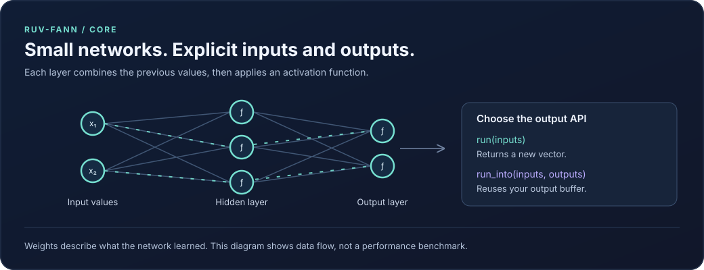
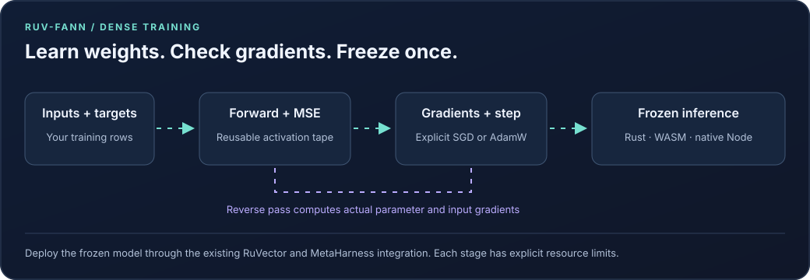
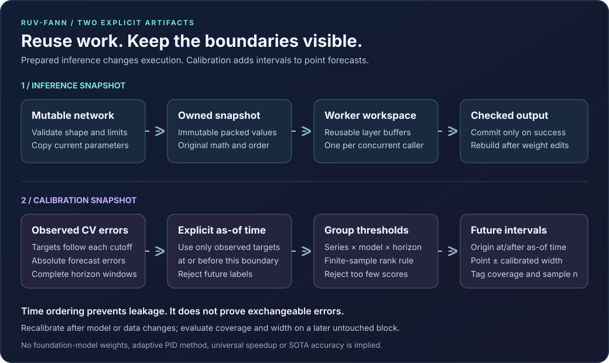
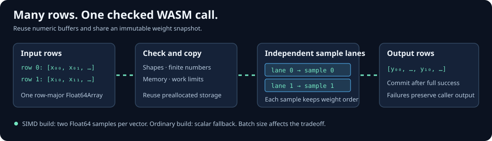
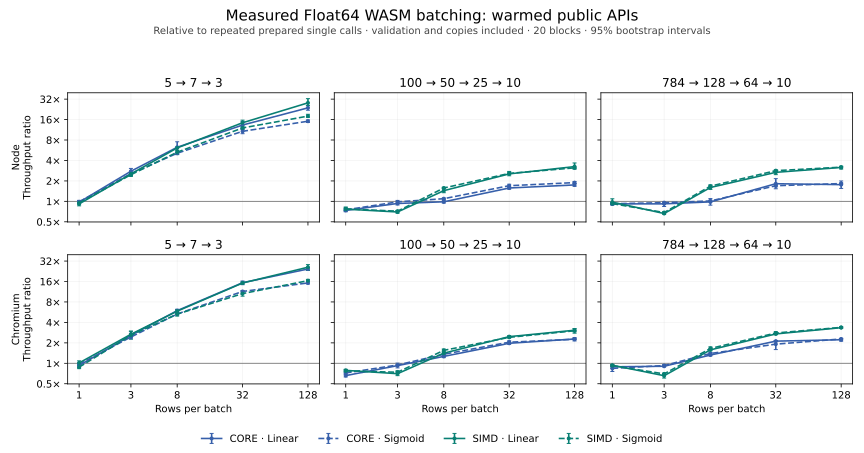
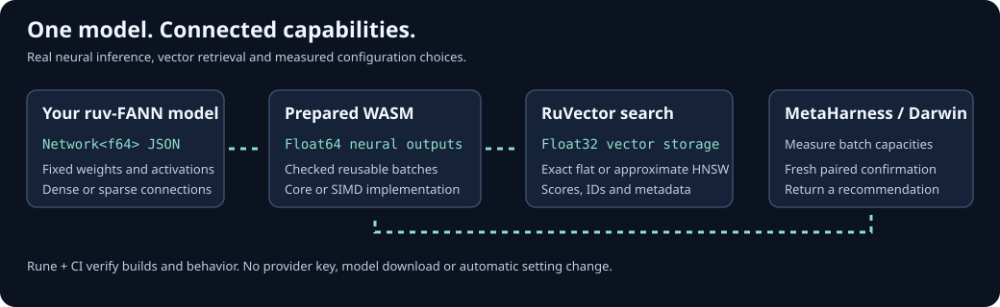
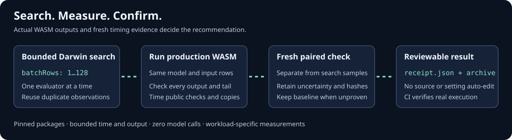

# ruv-FANN

Rust libraries for neural networks, time-series forecasting, agent coordination, GPU compute, and image processing.

[](https://crates.io/crates/ruv-fann)
[](https://docs.rs/ruv-fann)
[](https://github.com/ruvnet/ruv-FANN/actions/workflows/ci.yml)

**Start with `ruv-fann` if you need a small feedforward neural network in Rust.** It provides generic floating-point networks, training algorithms, and model I/O inspired by [FANN](https://github.com/libfann/fann). Other directories contain separate libraries and tools with their own build requirements.


## Choose a package

| Location | Available behavior | Candidate versions / guide |
| --- | --- | --- |
| Repository root | `ruv-fann`: train feedforward networks, prepare immutable CPU inference snapshots, and use optional WebGPU operations | `0.2.2` · [Core example](examples/basic_usage.rs) · [API](https://docs.rs/ruv-fann) |
| `integrations/candle/` | Import actual Candle CPU linear layers and compare training gradients/SGD/AdamW with Candle | `ruv-fann-candle 0.1.0` · [Candle guide](integrations/candle/README.md) |
| `bindings/napi/` | Native Node inference and dense autograd through napi-rs, sharing the Rust core | `@ruv-fann/napi 0.1.0` · [Native Node guide](bindings/napi/README.md) |
| `ruv-swarm/` | Fourteen Rust packages for scheduling, persistence, transport, MCP, CLI, and WASM | `1.0.6`–`1.0.8`; unified WASM `2.0.0` · [Rust guide](ruv-swarm/README.md) |
| `ruv-swarm/npm/` | Node CLI/MCP, SQLite state, prepared WASM inference, historical forecast intervals, and capability assignment | `ruv-swarm 2.0.0` · [npm guide](ruv-swarm/npm/README.md) |
| `integrations/ruv-fann/` | Use ruv-FANN neural outputs in RuVector search and tune inference batches with MetaHarness | `@ruv-fann/integrations 0.1.0` · [Integration guide](integrations/ruv-fann/README.md) |
| `neuro-divergent/` | Six Rust packages: RNN training, baselines, chronological evaluation, residual-calibrated intervals, and checkpoints | `0.2.0` · [Forecasting guide](neuro-divergent/README.md) |
| `cuda-wasm/` | Translate a CUDA subset to Rust or WGSL source; Node wrapper requires the external `cuda2rust` compiler | Rust `0.2.0`; npm `2.0.0` · [Translator guide](cuda-wasm/README.md) |
| `opencv-rust/` | Portable Rust matrices, browser image operations, a small SDK, and native OpenCV C++ bindings | Portable/SDK `4.9.0`; native `opencv-sys 0.2.0` · [Image-processing guide](opencv-rust/README.md) |

The five main Cargo workspaces have separate build requirements; the optional Candle and napi-rs packages each have their own workspace and lockfile. Running `cargo test` at the repository root tests the core crate; use the verification driver below to cover the other workspaces. Versions in this checkout are unpublished release candidates. The dated [release inventory](docs/release-inventory.json) records the earlier package identities and registry observations; `scripts/verify-packages.py --inventory` reports the current checkout.

Each family has a defined scope. Forecasting currently implements a univariate RNN and simple baselines; LSTM/GRU forecasting architectures return unsupported errors. Agent assignment records scheduling decisions; external task execution depends on the integration you supply. CUDA translation emits source and does not execute a GPU kernel. The native OpenCV bridge calls an installed C++ library, while the portable packages implement a smaller set of operations.

## Weight-space programming in Node.js and browsers

Install `ruv-fann-wsp` for bounded direct parameter edits and a real-WASM workbench:

```sh
npm install ruv-fann-wsp
```

Version 0.2.0 adds canonical model inspection, affine/activation traces, hidden-neuron
ablation patches and finite-difference sensitivity analysis. Edits still require
explicit evaluation and promotion; revisioned checkpoints support rollback.
See the [WSP package guide](packages/wsp/README.md) and the
[public-data benchmark](packages/wsp/benchmarks/README.md). The benchmark compares
linear and small neural models against simple baselines and ExtraTrees on Iris and
Wine. All outcomes are retained; it establishes no state-of-the-art or agent-task
performance claim.

## Try the neural-network core

Install [Rust](https://www.rust-lang.org/tools/install), then run the included example:

```bash
git clone https://github.com/ruvnet/ruv-FANN.git
cd ruv-FANN
cargo run --locked --example basic_usage
```

For the published crate, run `cargo add ruv-fann` in your application. To try changes from this checkout, use `cargo add ruv-fann --path /path/to/ruv-FANN` instead. Published API documentation describes the published version; new checkout APIs become available after a release.

This example uses explicit weights so you can check the result without training:

```rust
use ruv_fann::{ActivationFunction, NetworkBuilder};

fn main() -> Result<(), Box<dyn std::error::Error>> {
    let mut network = NetworkBuilder::<f32>::new()
        .input_layer(2)
        .output_layer_with_activation(1, ActivationFunction::Linear, 1.0)
        .build();

    // Two input weights, followed by the bias weight.
    network.set_weights(&[0.5, -0.25, 0.1])?;
    let outputs = network.run(&[1.0, 2.0])?;
    assert!((outputs[0] - 0.1).abs() < 1e-6);
    println!("Output: {}", outputs[0]);

    Ok(())
}
```

The calculation is `0.5 × 1.0 − 0.25 × 2.0 + 0.1 = 0.1`. A real task needs suitable data and trained weights. [Training examples and algorithms](src/training/mod.rs) include backpropagation, RPROP, Quickprop, Adam, and AdamW.



For repeated inference, the checkout adds `Network::run_into(inputs, outputs)`. Pass a mutable output slice whose length equals `num_outputs()`. It reuses that buffer and the network's stored neuron values. `run()` remains the convenient API that returns a vector. Check input and output lengths through the returned `Result`.

### ESP32 C5 inference

The [ESP32 C5 example](examples/esp32-c5) compiles a RuFANN dense JSON checkpoint into a native fixed point evidence scorer. The device accepts local and adjacent evidence from `0` to `1024`, where `1024` represents one. Scoring uses integer arithmetic and requires no heap allocation.

The supported checkpoint has two ReLU units with weights `[1, -1, 1, -1]`, followed by one linear unit with weights `[1, -1]` and zero bias. The hidden biases set the two hinges. For example, `[-0.125, -0.875]` subtracts a margin of `0.125` and caps the result at `0.75`. Both hinge values must be exact multiples of `1/1024` in `[0, 1]`, with the second greater than the first. Replace `examples/esp32-c5/model.json` and rebuild to apply a supported weight edit.

With Rust 1.90 or newer and [espflash](https://docs.espressif.com/projects/rust/book/getting-started/tooling/espflash.html) installed, run from the checkout:

```sh
cd examples/esp32-c5
cargo test --locked
rustup target add riscv32imac-unknown-none-elf
cargo build --locked --release --features firmware --target riscv32imac-unknown-none-elf
espflash flash --monitor --chip esp32c5 target/riscv32imac-unknown-none-elf/release/ruvfann-c5
```

The host test compares 1,089 scores with the Rust core. On a C5, the demo prints `ruvfann-c5 PASS cases=1089` after its boot self test. The printed duration includes the test loop and its reference calculation. For a CSI integration, pass window features to `score` from a worker and measure latency and packet loss with WiFi active.

To run the same boot test in [Espressif's emulator](https://github.com/espressif/esp-emulator), package a merged image with espflash, then select the USB JTAG console:

```sh
espflash save-image --chip esp32c5 --merge --skip-padding target/riscv32imac-unknown-none-elf/release/ruvfann-c5 /tmp/ruvfann-c5-flash.bin
esp-emu --chip esp32c5 --firmware /tmp/ruvfann-c5-flash.bin --console usb-jtag --timeout 10s --exit-on 'ruvfann-c5 PASS'
```

## Train with gradients, then freeze the result



The checkout adds `AutogradNetwork<f32>` and `AutogradNetwork<f64>` for an
explicit sequence of dense layers. You can inspect parameter and input
gradients, then apply SGD or AdamW. MSE means the average squared error over
every row and output. Linear, Sigmoid, Tanh, SigmoidSymmetric and ReLU have
derivative rules; other activations return an unsupported error.

```rust
use ruv_fann::{ActivationFunction, AutogradNetwork, DenseLayer};
let mut model = AutogradNetwork::<f64>::from_dense_layers(&[DenseLayer {
    inputs: 1, outputs: 1, weights: &[0.0], bias: Some(&[0.0]),
    activation: ActivationFunction::Linear, steepness: 1.0,
}])?;
let mut tape = model.workspace(2, 1024 * 1024)?;
let loss = model.backward_mse(&[1.0, 2.0], &[2.0, 4.0], 2, &mut tape)?;
assert_eq!(loss, 10.0);
assert_eq!(tape.parameter_gradients(), &[-10.0, -6.0]); // weight, then bias
model.sgd_step(&mut tape, 0.1)?;
let frozen = model.prepare()?;
```

Run `cargo run --locked --example dense_autograd` for a complete AdamW learning
example. The tape and optimizer allocate during setup; repeated forward,
backward and update calls reuse their buffers. Each successful update consumes
its gradients. Training again requires a fresh backward pass. Frozen snapshots
keep their own weights after later training or model destruction.

Actual Candle CPU tensors can enter through the optional
[Candle adapter](integrations/candle/README.md). Its JSON export uses
`ruv-fann.dense-layers/1`, with `[outputs, inputs]` row-major weights and optional
bias. The same schema initializes Rust training, WASM
`runtime.createTrainableNetwork(json, maxRows)` and native
`NativeTrainableNetwork.from_dense_layers_json(json, maxRows)`.
`to_dense_layers_json()` stores topology and weights; optimizer moments are
separate state. A trained `prepare()` result works with the existing
[RuVector search and MetaHarness tuning](integrations/ruv-fann/README.md).

The [source review](docs/research-candle-2026-11-09.md) explains the design and
the actual Candle gradient oracle. This is fixed dense training; general tensor
graphs, transformers and GPU backward execution have separate requirements.

## Prepare a network for repeated inference



After training, `network.prepare()` copies validated parameters into an immutable
snapshot. Give each caller its own reusable workspace; several threads can share
the same prepared network without sharing mutable neuron caches:

```rust
let prepared = network.prepare()?;
let mut workspace = prepared.workspace()?;
let mut output = vec![0.0; prepared.num_outputs()];
prepared.run_into(&[1.0, 2.0], &mut output, &mut workspace)?;
```

Hot calls allocate no memory. Changing the original network does not change the
snapshot; prepare a new one after training or editing weights. Preparation rejects
invalid graph indices, non-finite parameters and noncanonical bias state. The
default estimated allocation budget is 64 MiB, including one workspace; this is
not a process-memory limit. A failed call leaves the output slice unchanged.

Dense rows use contiguous scalar arithmetic; sparse and reordered connections
retain their order. This path adds no external inference engine or quantization.
Run the [complete example](examples/prepared_inference.rs) with
`cargo run --locked --example prepared_inference`. The [current research review](docs/research-sota-2026-11-08.md)
explains adoption choices and separate benchmark/evaluation requirements.

## Run the same engines in WebAssembly

The `ruv-swarm` JavaScript package includes prepared inference and historical
forecast intervals in its ordinary and SIMD WASM binaries. In Node.js 22.13+:

```js
import { RuvSwarm } from 'ruv-swarm';
const runtime = await RuvSwarm.initialize();
const network = runtime.createNeuralNetwork([2, 1], 'Linear');
network.set_weights(Float64Array.of(2, -1));
const prepared = network.prepare();
network.free();
const output = new Float64Array(1);
prepared.run_into(Float64Array.of(3, 4), output); // [2]
prepared.free();
```

`runtime.createPreparedNetwork(networkJson)` also imports native Rust
`Network<f64>` JSON, retaining sparse connection order and all native activations.
`runtime.createConformalCalibrator(config)` fits the shared residual engine with
explicit past observations. Its timestamps are safe-integer Unix milliseconds.
See the [JavaScript guide](ruv-swarm/npm/README.md) for formats and limits, or
serve the [browser example](ruv-swarm/npm/examples/wasm-prepared-conformal.html)
over HTTP. The browser imports the generated WASM bindings directly.

`run_into` reuses Rust numeric buffers and the output array; JavaScript boundary
checks and copies still have a cost. The native f32 benchmark below does not
measure browser or Node.js latency. Historical intervals retain their documented
time-series coverage limitations. The [WASM results](docs/sota-results-2026-11-08.md#webassembly-extension)
show measured timings and the tradeoff for very small networks.

For many samples, create a fixed-capacity batch workspace. Native Rust supports
both f32 and f64; input and output slices contain one row after another:

```rust
let mut batch = prepared.batch_workspace(2, 1024 * 1024)?;
let inputs = [1.0, 2.0, 3.0, 4.0]; // two rows for a two-input network
let mut outputs = vec![0.0; 2 * prepared.num_outputs()];
prepared.run_batch_into(&inputs, &mut outputs, 2, &mut batch)?;
```

The JavaScript API exposes `prepared.create_batch(capacity)` and
`batch.run_into(inputs, outputs, rows)`. It reuses numeric buffers and can keep
running after the original prepared handle is freed. The SIMD build processes
independent samples in parallel without reordering any sample's weighted sum.



## Pick the features you need

| Feature | Purpose and limits |
| --- | --- |
| Default features | Enable model I/O, serialization, compression, logging, and parallel-related utilities. CPU inference does not require a GPU. |
| `io` | Enables file formats and training-data I/O. Keep bounds on bytes, decompressed data, and declared model dimensions when loading external data. |
| `simd` / `parallel` | Expose CPU optimization utilities. A feature being enabled does not mean every network or training operation uses vector instructions or multiple threads. Measure the path you call. |
| `gpu` | Enables the native Rust WGPU backend with checked matrix/batch dispatch, f32 activations, and managed device buffers. It needs a compatible device and driver. f64 compute uses the CPU to preserve precision. It does not route every network or trainer through a GPU. |
| `webgpu` / `wasm-gpu` | On `wasm32`, expose the async `WasmGpuBridge` for f32 matrix multiplication and activations in a browser with WebGPU. Buffers are limited to 64 MiB and device limits; matrix calls have a work budget. GPU unavailability returns an error. These features do not enable the native `gpu` backend. |
| `wasm` | Enables WASM-related bindings and dependencies. Browser execution has a separate test gate; target compilation alone does not establish browser behavior. |
| `no_std` | Currently a feature marker. The core still uses the Rust standard library; this is not a supported bare-metal `#![no_std]` build. |

See [Cargo.toml](Cargo.toml) for the precise feature dependency graph. Native Rust `gpu` tests use software Vulkan. Browser tests load the built Rust WASM bridge and verify matrix results, all 21 activations, invalid inputs, and device lifecycle with Chromium/SwiftShader. A separate harness directly checks all seven WGSL modules and Adam/AdamW updates. These checks establish numerical behavior on software adapters. Physical GPU throughput and every experimental training combination remain unevaluated. See the [core review](docs/review-core.md) for limits, tolerances, and commands.

## Build and test

Use a current stable Rust toolchain for full-repository development. The core declares Rust 1.81; native swarm packages require Rust 1.89 for patched SQLite. The minimal swarm WASM crate, napi-rs binding and all four OpenCV packages retain Rust 1.88. The optional Candle adapter is tested with Rust 1.99.1 and declares 1.99. Python 3.11 or newer runs the verification tools. Node 22.13 or newer covers the root tooling and swarm distribution; the standalone CUDA wrapper requires Node 22.12 or newer.

The full OpenCV workspace also needs a C++17 compiler, pkg-config, libclang, and OpenCV 4.4 or newer development files. On Debian/Ubuntu these are typically `g++`, `pkg-config`, `libclang-dev`, and `libopencv-dev`. See the [native setup guide](opencv-rust/opencv-sys/README.md) for a checked user-owned prefix option. Portable OpenCV packages can be tested with `--exclude opencv-sys`. Swarm's SQLite npm addon requires Python and a C++20 toolchain: installation builds a verified SQLite 3.54.1 source archive and checks its version, source ID, binary hash and Node ABI before opening user databases. See the [Node installation guide](ruv-swarm/npm/README.md).

```bash
# Inventory every Cargo workspace and npm distribution.
python3 scripts/verify-packages.py --inventory

# Check and test registered libraries, binaries, tests, examples, and benchmarks.
# Install the native OpenCV prerequisites first.
python3 scripts/verify-packages.py --check
python3 scripts/verify-packages.py --test

# Audit all five Cargo lockfiles (requires cargo-audit).
python3 scripts/verify-packages.py --audit

# Validate README links and the SVG diagram sources.
python3 scripts/verify-packages.py --docs
```

The driver uses `--workspace --all-targets`, enables all features for swarm and forecasting, and selects CUDA's portable `serde` configuration. It also runs the targeted safety regressions and reports every failed command. GPU/browser execution, npm consumers, and Cargo archive verification have separate gates recorded in the [modernization report](docs/modernization.md). An inventory or successful metadata resolution is not a passing test suite.

For work on the core alone:

```bash
cargo test --locked --lib
cargo test --locked --doc
cargo check --locked --no-default-features
cargo bench --locked --bench neural_network
```

To build and test the Rust browser GPU bridge, install wasm-pack, the root npm dependencies, and Playwright's Chromium, then run `node scripts/verify-rust-browser-gpu.cjs --build`. This checks generated Rust WASM through the public browser API. The bridge accepts `Float32Array` inputs and implements compute rather than canvas rendering or browser agent orchestration.

For a single family, pass `--workspace neuro-divergent` to the verification driver or use its manifest directly. The family guide explains optional features and native libraries. Run JavaScript commands from the relevant npm directory; the repository root is an integration harness. See each npm guide for a clean install, genuine artifact build, tests, and packed-consumer validation.

## Performance and research

Measure the workload you intend to deploy. Record the commit, compiler, CPU or GPU, target features, model shape, batch size, thread count, warm-up, and numeric tolerance. Compare identical inputs and weights, and include allocation and transfer costs in end-to-end results. Criterion output is written under `target/criterion/`.

The latest comparison uses actual Float64 WASM in Node and Chromium. A
128-row SIMD batch produced these mean per-row latencies, including JavaScript
validation and copies. Speed ratios compare repeated prepared single calls in
the same binary; setup and compilation are outside the timings.

| Linear network | Node 24 | Chromium 156 | Chromium speed ratio |
| --- | ---: | ---: | ---: |
| 5 → 7 → 3 | 83.3 ns | 87.6 ns | 25.96× |
| 100 → 50 → 25 → 10 | 2.11 µs | 2.22 µs | 3.07× |
| 784 → 128 → 64 → 10 | 29.38 µs | 29.02 µs | 3.35× |



These single-host results are workload-specific. One-row batches can be slower;
the native f32/f64 comparison also shows small-batch regressions. Release WASM
uses optimization level 3 and checked arithmetic: compared with the size profile,
the binaries grow by about 65 KB each. All measured inference outputs match,
and old/new calibration JSON is byte-identical. The
[full results](docs/ultra-results-2026-11-08.md) include raw samples, confidence
intervals, native calibration results, and reproduction commands. See the
[research review](docs/research-sota-2026-11-08.md) for adoption choices and
the [earlier modernization report](docs/modernization.md) for package verification.

## Verify frozen builds with Rune

[Rune](https://github.com/ruvnet/rune) now checks a runnable product built from
this repository's actual core. The integration pins Rune's source revision and
lockfile, builds it locally, then freezes a plan, replays it and rebuilds in a
fresh target directory. The digest-bound executable exercises f32/f64 batches
and historical calibration; separate release tests cover the core library.

```sh
python3 scripts/rune.py plan --repo .
python3 scripts/rune.py --help
```

Setup and dependency fetching are explicit steps. Verification uses Cargo
offline, records zero model calls, and rejects stale source, a changed plan or
a corrupted stored artifact. It copies source into an isolated directory and
leaves project files and existing locks intact. This is build provenance and
correctness evidence; it does not measure a performance gain or provide an OS
sandbox. The [setup guide](docs/claude-plugin.md#rune-build-verification) explains
the commands and scope. The [Rune workflow](.github/workflows/rune.yml) runs on
relevant pushes/PRs and is also part of the full release acceptance gate.

## Connect ruv-FANN to other ruvnet packages

The optional [integration package](integrations/ruv-fann/README.md) connects actual
neural inference to RuVector and MetaHarness. Import a native Rust `Network<f64>`
JSON export into the existing prepared WASM runtime, index its neural outputs
with RuVector flat or HNSW search, and measure batch configurations with Darwin.
The core library does not acquire these dependencies.

```sh
npm ci --prefix integrations/ruv-fann --ignore-scripts --omit=optional
npm run example --prefix integrations/ruv-fann
```



The package exposes typed APIs for numerical feature search and reusable batch
encoding. It uses fixed model weights, explicit local WASM bytes, bounded inputs
and clear ownership. A trained model determines whether its vectors have useful
semantic meaning; no text embedding model is supplied. The Node-only tuner
recommends a setting only after fresh measurements and never applies it itself.
The [validation and retrieval measurements](docs/ruvnet-integration-results-2026-11-09.md)
include browser and extracted-package checks and the small-corpus tradeoff.

## Tune WASM batching with MetaHarness

The private [MetaHarness tool](tools/metaharness/) uses the real Darwin numeric
optimizer to search batch sizes for the shipped WASM. Every candidate processes
the same rows and must reproduce every reference output. A fresh paired
measurement checks the candidate after search; a faster search sample alone is
not enough for a recommendation.

```sh
npm ci --prefix tools/metaharness --ignore-scripts --omit=optional
node tools/metaharness/src/cli.mjs plan --repo .
node tools/metaharness/src/cli.mjs optimize --repo . --variant simd --model medium --baseline-batch-rows 128 --output /tmp/ruv-fann-tuning
```

Use POSIX (Linux or macOS) and Node 22.13+. Set the baseline to your current batch
size (the default is one row). Use a new output directory for each run. The loop
bounds evaluations, time and
output, reuses identical observations, and records raw timings and confidence
intervals. It changes batch configuration inside the experiment, without
editing source or applying the result to production. The optional `score`
command is a static metadata assessment, separate from runtime tests.



The [detailed workflow](docs/claude-plugin.md#metaharness-optimization) explains
installation, presets, receipts and limits. The
[CI gate](.github/workflows/metaharness.yml) executes real core/SIMD trials on
supported Node versions without requiring a speedup on shared runners. No model
service or provider key is needed.

The [measured results](docs/metaharness-results-2026-11-09.md) include the
128-row control: no confirmed gain over that existing setting, which the loop
correctly retained.

## Contribute

Choose a package, reproduce the issue, and add a regression test for a behavior change. Run that package's checks and the relevant integration checks before opening a pull request. Include the commands and results so another contributor can reproduce them.

Model files, training data, plugins, and network messages cross trust boundaries. Changes to those inputs should validate dimensions and resource use before allocating, return useful errors, and preserve format compatibility or document a migration. See the [deserialization decision](docs/adr/ADR-001-deserialization-safety.md) and [migration notes](docs/MIGRATION.md).

## Credits and license

Thanks to the contributors listed in [CONTRIBUTORS.md](CONTRIBUTORS.md), including Ocean (@ohdearquant), Bron (@syndicate604), Jed (@jedarden), and Shep (@elsheppo), and to the FANN, Rust, NeuralForecast, Tokio, Serde, and WebAssembly communities.

See the repository [LICENSE](LICENSE) and each package's manifest for licensing information.
