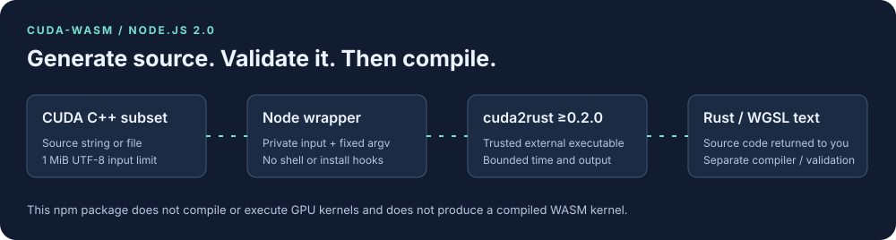

# CUDA-Rust-WASM

`cuda-rust-wasm` is an experimental Rust toolkit for reading a subset of CUDA C++, generating Rust or WGSL text, and experimenting with CPU reference kernels. CUDA is an NVIDIA trademark; this project is independent of NVIDIA.

The Rust library and `cuda2rust` command are published on crates.io as `cuda-rust-wasm` 0.2.1. The `cuda-wasm` npm package (2.0.1) has a smaller, working contract: a Node.js wrapper around that command, returning Rust or WGSL **source text**.



## Use the Node.js package

Node.js 22.12 or newer and a trusted `cuda2rust` 0.2.0-or-newer executable are required. npm installation has no install hooks, downloads no executables, and builds no native modules. The package has no npm runtime dependencies.

Install both:

```bash
npm install cuda-wasm@2
cargo install cuda-rust-wasm --version 0.2.1 --locked
```

For this checkout, build the real command and point the wrapper at it:

```bash
cargo build --locked --manifest-path cuda-wasm/Cargo.toml --bin cuda2rust
export CUDA2RUST_BINARY="$PWD/cuda-wasm/target/debug/cuda2rust"
node cuda-wasm/cli/index.js transpile vector_add.cu --target rust
node cuda-wasm/cli/index.js transpile vector_add.cu --target wgsl --output vector_add.wgsl
```

Those shell examples run from the repository root. On Windows, set the environment variable to the built `cuda2rust.exe`, or pass the executable's absolute path with `--binary`. `--output` creates a new file; overwriting an existing output requires `--force`.

CommonJS:

```javascript
const { transpileCuda } = require('cuda-wasm');

async function main() {
  const result = await transpileCuda(
    '__global__ void copy(float* a, float* b) { b[0] = a[0]; }',
    { target: 'wgsl' }
  );
  console.log(result.code);
  console.log(result.compilerVersion);
}
main().catch(console.error);
```

ES modules use the same API: `import { transpileCuda } from 'cuda-wasm'`. `transpileFile(path, options)` reads a file instead of accepting source directly. Both return a promise of `{ code, target, compilerVersion }`. The output needs separate Rust compilation or WGSL validation and numerical comparison; source generation does not execute a GPU kernel or produce a compiled `.wasm` kernel.

| Option | Default | Meaning |
| --- | --- | --- |
| `target` | `rust` | Generate `rust` or `wgsl` source. |
| `binary` | `CUDA2RUST_BINARY`, then `cuda2rust` on `PATH` | Path/name of the trusted external executable. Arguments are passed without a shell. |
| `timeoutMs` | `30000` | Per-process time limit, from 1 to 120000 ms. Version checking and source generation are separate processes. |
| `maxOutputBytes` | `4194304` | Per-stream output bound, up to 16 MiB. Version output has a separate 4096-byte bound. |

Input is limited to 1 MiB of well-formed UTF-8. The wrapper uses a private temporary source file and removes it after success or compiler failure. File input is bounded even if the file grows during reading. Error objects have stable `code` values such as `E_INPUT_LIMIT`, `E_COMPILER_NOT_FOUND`, `E_COMPILER_VERSION`, `E_TIMEOUT`, and `E_OUTPUT_LIMIT`; compiler failures also expose a bounded `compilerStderr` and numeric `exitCode` when available. `getCompilerVersion()` verifies the executable; `getVersion()` reports the npm version without invoking it.

## Migrate from npm 1.x

Version 2 removes APIs and artifacts that the checked-in implementation could not supply reliably.

| Previous usage | Version 2 |
| --- | --- |
| `transpileCuda(filePath, options)` | Pass source text, or use `transpileFile(filePath, options)`. Both APIs are asynchronous. |
| `target: 'wasm'` or `'webgpu'` | Choose `'rust'` or `'wgsl'` source. Compile/validate the returned source separately. |
| WASM binary, optimization lists, or estimated performance in the result | Read the actual `code`, `target`, and external `compilerVersion`. |
| `analyzeKernel`, `benchmark`, browser or `./wasm` imports | Removed. This npm release is Node-only and does not measure or execute kernels. |
| Automatic native/WASM installation | Install or build the explicit external compiler prerequisite. |

Legacy C++ bindings and WASM build-script sources remain in the repository for investigation. They are excluded from the npm archive and are not part of its build pipeline. `npm run build` validates the authored JavaScript, ES module, declaration, and CLI entry points; it does not create Rust or WASM binaries.

## Try the Rust library

From this repository, add a path dependency:

```toml
[dependencies]
cuda-rust-wasm = { path = "./cuda-wasm" }
```

```rust
use cuda_rust_wasm::CudaParser;

fn main() -> cuda_rust_wasm::Result<()> {
    let ast = CudaParser::new().parse(
        "__global__ void copy(float* a, float* b) { b[0] = a[0]; }"
    )?;
    println!("Parsed {} top-level items", ast.items.len());
    Ok(())
}
```

Generate code for inspection from the repository root:

```bash
cargo run --manifest-path cuda-wasm/Cargo.toml --bin cuda2rust -- transpile --input vector_add.cu
cargo run --manifest-path cuda-wasm/Cargo.toml --bin cuda2rust -- generate-wgsl --input vector_add.cu
```

Generated code needs compiler/shader validation and numerical comparison against the original kernel. The parser recovers from some unsupported constructs, so successful parsing alone does not establish equivalent behavior.

## Choose a backend

The default features enable serialization and portable CPU use. CPU and parser initialization do not discover GPU drivers or cloud instance metadata.

| Feature | Purpose | Extra requirements |
| --- | --- | --- |
| `serde` | Serialize AST and configuration values | None beyond Rust dependencies |
| `gpu` / `webgpu` | Opt into GPU discovery and wgpu-backed experiments | Working adapter and driver |
| `native-gpu` | Enable native CUDA/OpenCL dependencies | Vendor development libraries |
| `cuda-backend` | Enable the native CUDA backend | CUDA toolkit and a compatible driver |
| `vulkan` | Enable the optional Vulkan dependency | Vulkan SDK/driver |
| `nutanix` | Build the HTTP client/configuration integration | A configured Prism service for real operations |

Several Nutanix remote operations remain unimplemented. Local candidate discovery does not prove a Nutanix cluster exists or a migration occurred. GPU, browser and vendor-driver results must be measured separately from CPU tests.

## Memory and attention

`HostBuffer` and `DeviceBuffer` are initialized, aligned host allocations. They are not pinned CUDA memory or device allocations. Their constructors require `T: Default + Copy`; `fill` reuses the allocation. Backend allocations are managed separately.

Raw backend memory copies and kernel launches are `unsafe` APIs. Callers must supply valid live memory, a matching kernel argument ABI, correct synchronization and trusted kernel code. The kernel memory manager keeps its owned backing vectors and returns correctly aligned pointers.

The tiled attention implementation is a CPU reference using online softmax. It reuses score scratch storage and avoids allocating a full score matrix. It is not the fused GPU implementation from FlashAttention-2/3. Nonzero dropout is rejected rather than silently ignored.

The recursive CUDA parser accepts at most 1 MiB of source, nesting depth 32, and 256 non-whitespace characters per uninterrupted expression/declaration. Comments and strings are excluded from the expression budget. Inputs beyond these limits return errors; use smaller source units for generated kernels.

## Check this checkout

```bash
cargo test --manifest-path cuda-wasm/Cargo.toml --all-targets --locked
cargo check --manifest-path cuda-wasm/Cargo.toml --all-targets --no-default-features --locked
cargo audit --file cuda-wasm/Cargo.lock
```

Hardware tests require opted-in GPU features. The [review report](https://github.com/ruvnet/ruv-FANN/blob/main/docs/review-cuda-cv.md) records commands, results, dependency advisories and release blockers. It contains no cross-framework speed claims.

For the Node wrapper, run from `cuda-wasm/`:

```bash
npm ci --ignore-scripts
npm test
npm run build
npm audit --audit-level=moderate
npm pack --dry-run
# Requires CUDA2RUST_BINARY pointing at the real executable:
npm run test:integration
```

Unit tests use explicitly labelled executable fixtures. The separate integration gate invokes the real Rust command and checks Rust/WGSL output through CommonJS, ES modules and the CLI. Neither gate proves kernel equivalence. The local Rust test runs recorded in the [review report](https://github.com/ruvnet/ruv-FANN/blob/main/docs/review-cuda-cv.md) passed 743 tests with default features and 730 with no default features. wasm32 target compilation passed; browser execution remains a separate check.

## Measure CPU behavior

The benchmark targets use the APIs implemented in this checkout: initialized host
buffers, pooled reuse, CPU kernel dispatch, tiled reference attention, scalar/SIMD
vectors, profiling, and CUDA parsing/Rust/WGSL text generation.

```bash
cargo bench --manifest-path cuda-wasm/Cargo.toml --bench cpu_vector_benchmarks
cargo bench --manifest-path cuda-wasm/Cargo.toml --features regression-tests --bench regression_benchmarks -- --save-baseline reviewed
# Compare a later run on the same machine with --baseline reviewed.
```

The previous `wasm_vs_native_benchmarks` target is replaced by
`cpu_vector_benchmarks`. Invented CUDA timing estimates, 70% performance targets,
synthetic standard deviations and machine-dependent test time limits were removed.
Criterion measures real operations and distributions. These targets do not
compare a CUDA device to WASM execution. The final portable all-target run passed
744 tests and 40 benchmark smoke cases; the optional regression target passed two
more smoke cases. These checks establish runnable benchmarks, not a speed claim.

## Research and next steps

The [CUDA programming guide](https://docs.nvidia.com/cuda/cuda-programming-guide/), [WGSL specification](https://www.w3.org/TR/WGSL/) and [FlashAttention implementation](https://github.com/Dao-AILab/flash-attention) define the relevant language and hardware contracts. A future wgpu major-version migration needs shader validation and adapter tests. New numerical kernels need reference comparisons and reproducible benchmarks before being advertised as faster.

See [LICENSE](LICENSE) and the release report for the current license-file/manifest review.
