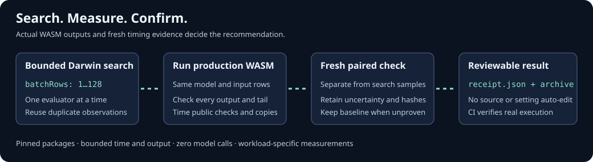

# MetaHarness tunes a measured WASM configuration

Measured on 2026-11-09 UTC, starting from repository commit
`3497cb7923f305ffc7ef8711a2ebad5032c6cdae`. This integration adds a bounded local
optimization loop and CI. It does not change the inference implementation or
apply a new production setting. The existing 128-row setting was retained when
the search could not confirm an improvement.

## Implementation and upstream review

The private [tool](../tools/metaharness/) pins `metaharness` 0.4.21 and
`@metaharness/darwin` 0.13.0. It calls the actual exported `evolveNumeric` engine.
Upstream source review used
[`ruvnet/metaharness` at `b27878cf`](https://github.com/ruvnet/metaharness/tree/b27878cf39d3ada6b2c4d1bcc3e9258a70c6cfd6).
That review commit does not establish the provenance of published npm bytes;
receipts separately record npm integrity and installed distribution hashes.

The single gene is integer batch capacity, from 1 to 128. Linear Float64 presets
use identical deterministic weights and row-specific inputs for all trials.
Every trial runs the shipped core or SIMD WASM and compares every output against
legacy single-row inference, including exact active lengths for partial batches.
The ordinary and SIMD experiments are separate; ratios do not isolate SIMD.

Search observations are cached by capacity. A selected candidate then undergoes
new interleaved paired measurements. Only a changed capacity whose 95% bootstrap
lower speed ratio exceeds 1.05 can replace the baseline in the recommendation.
An inconclusive result retains the caller's baseline. The option
`--baseline-batch-rows` defaults to one; set it to the configuration actually used.

## Final measurements

Host: AMD EPYC 9V74, Linux x64, a four-vCPU quota and 16-GiB memory limit. All five
runs passed exact output checks and source-aware WASM verification before and
after execution. Values below are fresh confirmation ratios of mean whole-workload
times, baseline divided by candidate. Search maxima are not these estimates.

| Workload / runtime | Baseline → candidate rows | Recommended rows | Fresh ratio [95% interval] | Outcome |
| --- | ---: | ---: | ---: | --- |
| Tiny core / Node 22.13.0 | 1 → 33 | 33 | 15.57× [15.11, 16.01] | Confirmed against one row |
| Tiny SIMD / Node 24.22.1 | 1 → 33 | 33 | 15.22× [13.94, 16.66] | Confirmed against one row |
| Medium SIMD / Node 24.22.1 | 1 → 109 | 109 | 4.14× [3.82, 4.45] | Confirmed against one row |
| Large SIMD / Node 24.22.1 | 1 → 109 | 109 | 3.60× [3.54, 3.65] | Confirmed against one row |
| Medium SIMD / Node 24.22.1 | 128 → 96 | **128** | 0.99× [0.95, 1.02] | No confirmed improvement |

Tiny CI-sized runs use five paired blocks and 128 input rows. The other runs use
20 paired blocks and 512 rows. Medium is 100 → 50 → 25 → 10; large is
784 → 128 → 64 → 10; tiny is 5 → 7 → 3. Two-generation searches dispatch seven
trials. The one-row medium/large runs perform five independent search measurements
and reuse two observations. The 128-row run performs six and reuses one. Fresh
confirmation is additional work, recorded separately from search accounting.

A separate control compared 109 with the previously measured 128-row setting:
medium was 1.007× [0.972, 1.046], large 0.998× [0.968, 1.033]. Neither cleared
confirmation. There is **no established speed gain over 128-row batching**.
The large one-row ratios measure call grouping within the same binary, not a
new engine-wide release speedup.

Timings include public JavaScript checks, copies, and all tail calls over the
fixed number of rows. Fixtures, reference checks, workspace creation and output
validation are outside the timed blocks. One observed creation cost and estimated
workspace bytes are separate fields. Nanosecond units derive from
`performance.now()` milliseconds. Intervals use 2,000 paired timing-block bootstrap
resamples; they describe this host and workload, not other machines, cold starts,
forecasting accuracy, or drift across days. Five blocks in CI are a correctness
smoke check, not a publication-quality performance estimate.

The [raw measurements](benchmarks/metaharness-2026-11-09.json) retain every search
sample, cache identity, paired confirmation sample, workload identity and original
receipt digest. The [validation record](metaharness-validation-2026-11-09.json)
records tool sources, checks and evidence digests. Existing benchmark records are
unchanged.

## Boundaries, fixes and CI

The adapter independently bounds the real engine's two-parent expansion:
`1 + children + 2*children*(generations-1)`, at most 12 dispatches with concurrency
one. It rejects a regressed archive winner and validates that recommendations
refer to measured, correct trials. A detached child has a wall deadline, combined
output cap, process-group cleanup and an environment allowlist. Inputs must be
bounded ordinary files, and the archive must be new. These controls do not create
an operating-system sandbox for hostile code.

The optional `score` command invokes the real MetaHarness static scorer on a
bounded public metadata projection. It refuses a resolvable optional embedding
model, including one inherited from an ancestor directory. Static scores and
estimated costs are separate from runtime evidence. Neither command exposes
arbitrary evaluator shell commands, source editing, model calls, promotion or
publication.

Final checks passed: 27 tool tests on each of Node 22.13.0 and 24.22.1; 27
MetaHarness workflow tests (46 with Rune); 39 portable Claude plugin tests;
the exact CI evidence guard on both genuine
core/SIMD receipts; syntax checks and source-aware artifact verification. The
installed tool dependency audit and supplementary Ruflo code scan reported zero
findings. These scans supplement the boundary tests and independent code review.

The [standalone/reusable CI workflow](../.github/workflows/metaharness.yml) installs
only the private exact lock, audits it, runs tests and actual core/SIMD loops on
Node 22 and 24, validates evidence, uploads results and requires an unchanged
checkout. A positive speed ratio is never a shared-runner gate. The full release
workflow also calls this gate; Rune remains its separate native build gate.

All ten existing locks and both production WASM binaries retain their original
bytes. The new lock belongs only to the private optimization tool. Claude plugin
0.1.3 adds the documented procedure; portable validation does not assert new
Claude host certification. See the [usage guide](claude-plugin.md#metaharness-optimization)
for installation and reproducible commands on POSIX with Node 22.13+.
