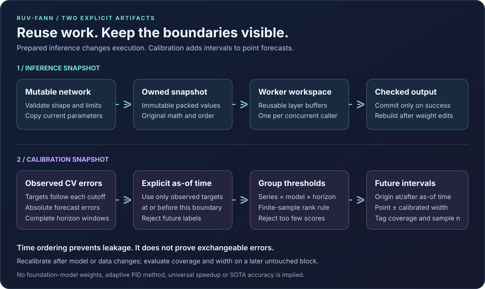

# Prepared inference and forecast calibration: research decisions

Reviewed **2026-11-08 UTC**, after repository baseline `b2314b5`. Sources below were available by this date. Repository revisions are pinned at or before 18:13 UTC; model metadata was read without downloading weights. This document records implementation choices and acceptance criteria. Measurements are recorded separately in the [implementation results](sota-results-2026-11-08.md).

The useful next step is to make two artifacts explicit: a validated, immutable inference snapshot, and a calibration table built from observed past forecast errors. Neither artifact implements a foundation forecasting model or reproduces a current adaptive conformal method.



## Decisions for this iteration

| Implement now | Why | Deliberately defer |
| --- | --- | --- |
| An owned, contiguous `PreparedNetwork<T>` with separate caller-owned scratch space | Makes topology/weight lifetime explicit and removes repeated object traversal without silently caching a mutable network | XNNPACK/KleidiAI bindings, quantization, ISA-specific packed formats, automatic batching, and serving schedulers |
| Absolute-error split-conformal calibration per **series, model, and horizon** | Provides inspectable interval widths, explicit time boundaries, and a finite-sample quantile rule | AcMCP, adaptive conformal inference, PID-Expert aggregation, learned quantiles, and automatic online recalibration |
| A documented foundation-model evaluation plan | Allows an external comparison with a disclosed checkpoint, license, runtime, and chronological task | Downloading checkpoints, introducing a Python/PyTorch runtime dependency, provider calls, or claiming model parity |

## Prepared inference: what current kernels teach us

XNNPACK's public API separates a packed-weights cache, a workspace, and a runtime. Hard finalization prohibits insertion and makes cache memory read-only; soft finalization permits reuse of already cached weights and rejects new ones. Its lookup key includes a packing-algorithm fingerprint. This is evidence for treating persistent weights and temporary execution memory as different lifetimes. It does not make this project's contiguous layout an XNNPACK-compatible format. The pinned source has a BSD-style license with component notices. [XNNPACK header, revision `163fab0d`, 2026-11-07](https://github.com/google/XNNPACK/blob/163fab0d681bed635bbcc7f4e35e13458db98cf4/include/xnnpack.h#L2296) · [license](https://github.com/google/XNNPACK/blob/163fab0d681bed635bbcc7f4e35e13458db98cf4/LICENSE).

KleidiAI's July 2025 MLAS integration example explicitly packs inputs and packs the right-hand weights only when the caller has not already supplied the required packed representation. Kernel selection checks hardware and supported shapes. Its naming guide ties a packing kernel's output layout to the matching compute kernel's input layout. Therefore an arbitrary contiguous buffer must not be passed to a specialized microkernel merely because its element count matches. These are Apache-2.0 sources; no external kernel code is incorporated here. [Integration example, revision `90bcf257`, 2026-11-06](https://github.com/ARM-software/kleidiai/blob/90bcf257c8c55c7dc65d92b98df87482a03a5004/docs/framework_integration_examples/kleidiai_mlas_integration.md) · [layout naming](https://github.com/ARM-software/kleidiai/blob/90bcf257c8c55c7dc65d92b98df87482a03a5004/docs/microkernel_names.md) · [license](https://github.com/ARM-software/kleidiai/blob/90bcf257c8c55c7dc65d92b98df87482a03a5004/LICENSES/Apache-2.0.txt).

**Our inference from those designs:** prepare once from a valid network, own the copied parameters, and give each worker its own reusable workspace. Rebuild after training or editing the original network. Keep sparse/shuffled/duplicate connection indices in their original accumulation order; a dense fast path must preserve the same mathematical computation. The initial portable implementation does not require a hardware-specific layout or unsafe vector loads.

[Packrat, ICML 2025](https://proceedings.mlr.press/v267/bhardwaj25a.html) studies the combination of model instances, threads per instance, and batch sizes in CPU serving. It motivates a later workload-dependent serving experiment. It is not a weight-packing algorithm, and its published latency ratios are not measurements of this library. This iteration exposes independent workspaces; it adds no batch API or Packrat scheduler.

### Intended public contract

The implementation exposes these interfaces; its validation receipts record exercised behavior:

```text
Network<T>::prepare() -> Result<PreparedNetwork<T>, PreparedError>
PreparedNetwork::from_network_with_limits(&network, PreparationLimits)
prepared.workspace() -> Result<InferenceWorkspace<T>, PreparedError>
prepared.run_into(&inputs, &mut outputs, &mut workspace)
```

The snapshot owns its parameters and uses the canonical f32/f64 activations. Scratch consists of reusable layer buffers and belongs to the caller. Preparation validates execution-relevant topology/parameters, including strict canonical bias, while ignoring overwritten regular-neuron cached sums/values. Defaults permit at most 1,048,576 neurons, 16,777,216 connections, and a 64 MiB estimate including descriptors, parameters, and one two-buffer workspace; checked budgets are not a hard process-RAM ceiling. Inference checks dimensions, workspace compatibility, finite inputs, and numeric overflow; output is committed only on success. Training and mutation remain on `Network`, with a new preparation required to use changed weights. There is no automatic cache invalidation, packed-model serialization, explicit SIMD, GPU dispatch, or new batching interface in this contract.

### Requirement-to-test criteria

| Requirement | Acceptance evidence |
| --- | --- |
| Same computation | Compare ordinary and prepared inference for f32/f64, every canonical activation, irregular widths, bias connections, and sparse/shuffled/duplicate edges; preserve documented accumulation order |
| Snapshot independence | Prepare, then edit/train/drop the original; the prepared outputs stay unchanged; a newly prepared object reflects valid edits |
| Safe allocation boundaries | Oversize limits and arithmetic overflow fail before allocating the declared snapshot/workspace; malformed topology returns a typed error |
| Reusable state | Repeated successful calls allocate zero times after workspace creation; rejected dimensions/nonfinite inputs preserve output; a later valid call still works |
| Worker isolation | Share one immutable snapshot and use separate workspaces on multiple threads; compare each result with its sequential reference |
| Honest cost | Isolate warmed inference from setup; label whether setup timing combines preparation, workspace allocation, and destruction; also report snapshot/workspace bytes and the stated amortization calculation |

Timing must use identical weights, shapes, inputs, compiler/target flags, and numeric checks. Keep both convenient `run` and allocation-free `run_into` baselines. Report confidence intervals and a quiet-host methodology before claiming a speedup. A lower allocation count alone does not establish lower latency.

## Forecast intervals: a transparent baseline

For each `(series, model, horizon)` group, collect **absolute** observed errors `|y - forecast|`. With `n` calibration scores and requested coverage `c`, choose the sorted score at one-based rank `ceil((n + 1) * c)`. If that rank exceeds `n`, return an insufficient-calibration error instead of clamping to the largest score. For example, 90% coverage needs at least nine scores in each group for a finite empirical cutoff. Bounds are `point ± cutoff`; this is symmetric absolute-error calibration, not a learned predictive distribution. [Finite-sample split-conformal background, Angelopoulos and Bates, version 6, 2022-12-07](https://arxiv.org/abs/2107.07511v6).

The usual finite-sample marginal coverage argument requires exchangeable calibration and future scores with an appropriately fixed forecasting procedure. Chronological CV prevents future-target leakage, but does not establish exchangeability. Refit windows, overlapping targets, distribution shifts, and shared training histories can create dependence. Partitioning by horizon is useful bookkeeping; it does not remove those dependencies or provide joint coverage of an entire trajectory. Report empirical coverage and width on a later, untouched evaluation block rather than presenting requested coverage as achieved coverage.

### Current adaptive research, with versions

Wang and Hyndman's **AcMCP** has a February 2, 2026 revision, [arXiv `2410.13115v2`](https://arxiv.org/abs/2410.13115v2). It derives serial dependence through lag `h − 1` under its stated autoregressive setting and motivates accounting for multi-step errors. A newer revision already existed at this review's cutoff: [version 3, **2026-11-05**](https://arxiv.org/abs/2410.13115v3). It explicitly treats delayed feedback and states horizonwise long-run coverage and finite-time empirical-shortfall bounds. Those results belong to its online algorithm and analysis, not to a static quantile of this repository's CV errors.

[PID-Expert, arXiv `2610.02777v1`, **2026-10-02**](https://arxiv.org/abs/2610.02777v1), aggregates a fixed collection of evolving PID calibrators. Its analysis separates expert-loss regret from aggregate miscoverage control and includes a stability condition. It is a useful next comparison after a baseline exists. Implementing one fixed absolute-error quantile does not implement PID feedback, expert weighting, delayed-feedback updates, or that analysis. No paper code or text is copied in this iteration.

### Explicit calibration contract

```text
ConformalConfig::new(as_of: DateTime<Utc>, horizon, coverages)
ConformalCalibrator::fit(&cv_results, config)
calibrator.apply(&point_forecasts, &forecast_origins)
```

`forecast_origins` maps each series ID to its declared UTC origin. Calibration consumes complete, sorted horizon windows with finite targets/predictions and requires `cutoff < target_time <= as_of`. Application requires each origin to be at or after `as_of`, each forecast timestamp to be after its origin, and matching series/model/schema/horizon groups. Limits bound rows/groups and derived allocations. Sorting dates determines horizon position; it must not assume that calendar periods always have a fixed millisecond length.

`ConformalForecastDataFrame.data` retains the schema's ID/time column names and normal Datetime units/zones, then adds `model` (String), `horizon` (UInt32), `coverage`, `point`, `lower`, `upper` (Float64), `calibration_samples` (UInt64), and UTC-nanosecond `forecast_origin`/`calibration_as_of`. Current hard ceilings include 100,000 score records (CV rows × models), 10,000 groups, 16 coverage levels, 1,000,000 result rows, and 128 models, with bounded names/schema metadata. The fitted calibrator is a separate immutable artifact. It does not automatically track model weights or detect a refit. Changing the model, preprocessing, data regime, or forecasting procedure requires deliberate recalibration. This iteration adds no calibrator persistence, pipeline-builder switch, bootstrap sampling, or learned-quantile implementation.

| Requirement | Acceptance evidence |
| --- | --- |
| Correct order statistic | Hand-check ranks and bounds, ties, unsorted input, multiple coverages, insufficient `n`, nonfinite scores, inexact integer-to-f64 coercion, and overflow in residuals/endpoints |
| No future labels | Reject calibration targets after `as_of`, targets at/before cutoff, application origins before `as_of`, and forecasts at/before origin |
| Group separation | Different series/models/horizons with deliberately different errors produce their own widths; missing/mismatched groups error |
| Complete windows | Reject duplicate target keys, missing horizon rows, wrong horizon, ambiguous model columns, and inconsistent metadata |
| Timestamp correctness | Preserve supplied timestamp representation/zone and exact UTC origins; treat horizons as ordinal positions rather than generating calendar offsets |
| Valid empirical evaluation | Calibrate on past CV errors, then score a later block excluded from model selection and calibration; disclose refit policy, sample counts, interval width, coverage, and dependence limits |

The last criterion is an evaluation requirement, not a promise that a toy test establishes population coverage. Per-group sample counts can be small; pooling series or horizons would change the statistical procedure and needs a separate documented decision.

## Foundation models: actionable external evaluation, not a local implementation

The pinned [Chronos repository](https://github.com/amazon-science/chronos-forecasting/tree/1224fafa91e1ecd6674f5204066b159e40b5e4a1), revision dated **2026-10-05**, links the authors' [Chronos-2 report, `2510.15821v1`, 2025-10-17](https://arxiv.org/abs/2510.15821v1). Its current small and synthetic variants are separate pretrained transformers; neither is this repository's trained RNN. The synthetic variant's card describes synthetic-only univariate/multivariate training. This can support a later contamination-sensitive comparison, but does not prove that an arbitrary evaluation task is independent of all development choices. [Source license: Apache-2.0](https://github.com/amazon-science/chronos-forecasting/blob/1224fafa91e1ecd6674f5204066b159e40b5e4a1/LICENSE).

The following are **metadata observations**, not downloaded checkpoints or measured process memory. Dates in this table are checkpoint API last-modified dates, not inferred training dates or release milestones. API metadata reports F32 tensors; byte counts are for `model.safetensors`, including its header. Runtime memory also includes framework imports, activations, attention/grouping, workspaces, and batches.

| Checkpoint / pinned revision | Observed parameters / tensor file bytes | License observation and next use |
| --- | --- | --- |
| [Chronos-2-small](https://huggingface.co/autogluon/chronos-2-small/tree/ddec01313e50b6bc58ebaa92ede81bc24a3d9f9a), **2025-12-03** | 27,934,624 F32; **111,749,048 bytes**; 6 layers, width 512 | Card declares Apache-2.0; preferred first external CPU evaluation candidate |
| [Chronos-2-synth](https://huggingface.co/autogluon/chronos-2-synth/tree/3607918a9fd027d5c465d8213e46b98e2c041cea), **2025-12-03** | 118,985,888 F32; **475,963,368 bytes**; 12 layers, width 768 | Card declares Apache-2.0; compare synthetic-only training under the same disclosed tasks |
| [Chronos-2](https://huggingface.co/amazon/chronos-2/tree/29ec3766d36d6f73f0696f85560a422f50e8498c), **2026-06-05** | 119,477,664 F32; **477,930,472 bytes** | Card declares Apache-2.0; larger external reference, not a local backend |
| [TimesFM-3.0](https://huggingface.co/google/timesfm-3.0-pytorch/tree/43046b85ec22d584a13f8098c2ed39c889e129c2), **2026-09-02** | 330,710,976 F32; **1,322,898,824 bytes** | Separate non-commercial/non-production checkpoint license; defer downloaded-weight integration |

Both small/synthetic Chronos configs specify context length 8,192, patch size/stride 16, and at most 64 output patches. These are configured dimensions, not a promise of throughput or peak RAM. Their output quantile grids differ from the main checkpoint, so evaluation must explicitly align requested levels instead of equating every returned column. [Small metadata](https://huggingface.co/api/models/autogluon/chronos-2-small/revision/ddec01313e50b6bc58ebaa92ede81bc24a3d9f9a?blobs=true) · [synthetic metadata](https://huggingface.co/api/models/autogluon/chronos-2-synth/revision/3607918a9fd027d5c465d8213e46b98e2c041cea?blobs=true) · [main metadata](https://huggingface.co/api/models/amazon/chronos-2/revision/29ec3766d36d6f73f0696f85560a422f50e8498c?blobs=true) · [TimesFM metadata](https://huggingface.co/api/models/google/timesfm-3.0-pytorch/revision/43046b85ec22d584a13f8098c2ed39c889e129c2?blobs=true).

### TimesFM code and weights have different terms

The [TimesFM source revision `e51928e2`, 2026-09-29](https://github.com/google-research/timesfm/tree/e51928e27119cb17bebc005be2696b75e0a9e688) documents the August 2026 release and has an [Apache-2.0 repository license](https://github.com/google-research/timesfm/blob/e51928e27119cb17bebc005be2696b75e0a9e688/LICENSE). Its notice distinguishes that source and older checkpoints from the 3.0 downloaded weights. The pinned [3.0 checkpoint LICENSE](https://huggingface.co/google/timesfm-3.0-pytorch/blob/43046b85ec22d584a13f8098c2ed39c889e129c2/LICENSE) restricts the supplied materials to non-commercial/non-production use and separately distinguishes hosted API terms. The repository's authorized Google Cloud route does not grant a general commercial license to a downloaded checkpoint. No model weights were fetched or incorporated here.

### Next evaluation, when separately authorized

1. Start with the pinned Apache-card Chronos-2-small checkpoint in an isolated external Python/PyTorch evaluation environment; verify its complete terms, artifact checksum, package lock, CPU/device and dtype before running it. Keep it out of the Rust runtime dependency graph.
2. Freeze disclosed datasets, series IDs, covariate availability, context, horizon, chronological cutoffs, refit/model-selection policy, and the untouched final block. Compare against seasonal naive and the actual RNN on identical targets.
3. Record model/file load cost separately from warm inference, peak process/device memory, batch size, and input/output preparation. Do not estimate peak RAM from tensor-file size or convert an upstream speed ratio into a local result.
4. Score point errors and interval/quantile quality with aligned levels. Report interval width and empirical coverage per horizon and series group, with uncertainty/dependence limitations. Measure an external pretrained model and the local calibrator as different interventions.

External checkpoint execution, new datasets, provider spend, and model downloads are outside this iteration. The accompanying [ADR-007](adr/ADR-007-prepared-inference-and-conformal-calibration.md) records the accepted implementation boundary; the earlier [research review](research-modernization.md) and release receipts remain historical evidence.
