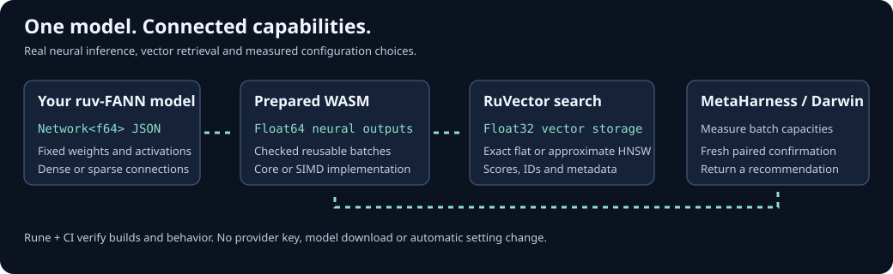

# ruv-FANN connects to RuVector and MetaHarness

The optional `@ruv-fann/integrations` 0.1.0 candidate provides application APIs
around real ruv-FANN prepared inference. It does not add RuVector or MetaHarness
dependencies to the Rust core. Work started from commit
`7e41f80d2e17f181528af5eaf71c13afba7ebd22`.

## The working integration

An application passes a real `WasmPreparedNetwork`, including one imported from
a native Rust `Network<f64>` JSON export. `createEncoder` batches its Float64
inference. `createNeuralIndex` converts outputs to finite Float32 vectors and
indexes/queries them using actual `@ruvector/wasm` 0.2.1 flat or HNSW search.
The Node-only `tuneBatchRows` calls actual `@metaharness/darwin` 0.13.0
`evolveNumeric` and returns an independently confirmed configuration suggestion.

The package exports browser ESM inference/retrieval, separate Node-only local
asset loading and tuning, public TypeScript declarations, and a runnable checkout
example. The [guide](../integrations/ruv-fann/README.md) explains installation and
ownership. No pretrained text model, embedding download or provider key is used.
Neural-output similarity is not by itself a semantic-accuracy claim.

## End-to-end checks

Forty unit tests pass on each of Node 22.13.0 and 24.22.1. They include actual
FANN inference and RuVector search, numerical/resource boundaries, all four
distance metrics, explicit-byte initialization, metadata isolation, reentrant
getters, ownership, and real-Darwin tests with controlled synthetic fixtures.
Those synthetic timing fixtures are regression tests, not performance results.

Each Node runtime also runs eight actual combinations of FANN core/SIMD,
native dense/sparse model exports, and RuVector flat/HNSW. Each compares 131
batched rows with single-row inference, including partial batches, with exact
Float64 output equality. Each index inserts 33 numerical records, returns the
expected nearest input, preserves copied metadata, deletes a record and rejects
malformed inputs. Closing the index retains the caller's prepared model.

Both runtimes repeat that acceptance against extracted npm packages using the
reviewed installed dependency graph, without another resolution/install. These
are four actual Node acceptance runs, totaling 32 retrieval cases and eight real
Darwin tuning loops. Chromium 156.0.8078.79 additionally passes four core/SIMD ×
flat/HNSW browser cases. Darwin tuning remains a Node-only API.

The public tuner retains the requested baseline unless a changed capacity has a
fresh paired 95% bootstrap lower speed ratio above 1.05. In the final source runs,
128 rows remained recommended on both Node versions and both FANN binaries.
Five-pair E2E timing is a correctness smoke check, not a general performance
estimate. Selection, cached observations, independent confirmation and temporary
archive cleanup are recorded separately.

The TypeScript build checks actual generated FANN-handle compatibility. All 69
workflow tests pass, including 23 new integration guard/failure-propagation tests;
39 portable Claude plugin tests and 27 existing private MetaHarness tests pass.
The exact new CI snapshot/evidence programs accept copies of genuine source and
packed receipts, leaving the originals unchanged. The integration dependency
audit and supplementary Ruflo 3.25.6 code scan report zero findings; neither
substitutes for the independent source review and boundary tests.

## Measured retrieval tradeoff

This fixed-workload benchmark uses actual SIMD FANN inference, Float64-to-Float32
conversion, public input validation, actual RuVector search, result copies and
metadata. Both indexes use the same native dense model (three input features,
two neural outputs), corpus and 32 held-out numerical queries with `k=10`.

| Records | Flat mean query | HNSW mean query | HNSW/flat throughput [95% interval] | Strict recall@10 against flat |
| --- | ---: | ---: | ---: | ---: |
| 128 | 27.80 µs | 39.36 µs | 0.71× [0.61, 0.82] | 1.00 |
| 2,048 | 107.22 µs | 35.08 µs | 3.06× [2.88, 3.24] | 1.00 |

Flat search was faster for the smaller corpus. HNSW reduced query cost at 2,048
records but had a higher observed insertion/encoding cost after index
construction: 120.81 ms versus 32.54 ms.
These are explicit backend choices; the adapter does not infer a universal
switching threshold from this benchmark.

Host: AMD EPYC 9V74, Linux x64, four-vCPU quota, 16-GiB memory limit, Node 24.22.1.
Twenty paired timing blocks alternate backend order after warmup. The 95%
interval uses 2,000 paired block bootstrap resamples. Nanosecond units in the
[raw measurements](benchmarks/ruvnet-neural-search-2026-11-09.json) derive from
`performance.now()` milliseconds. Recall describes 320 sampled neighbor IDs per
corpus against exact vector search, not semantic labels or all possible queries.
Equal-distance ties can affect strict ID recall. Other models, dimensions,
machines, insertion orders and cold starts require their own measurements.

## Scope and reproducibility

The [standalone/reusable CI gate](../.github/workflows/ruv-fann-integrations.yml)
installs only this package's exact lock, audits, builds types, runs boundary and
actual E2E tests, checks an extracted consumer, validates receipts, preserves the
checkout and uploads evidence. No shared-runner speedup is required. Existing
Rune and private MetaHarness gates remain separate.

Input dimensions, row counts, Float32 norms, metadata and logical payloads are
bounded. WASM bytes are explicit and trusted executable code; this is not a
sandbox for hostile modules. Caller `modelId` is a label, not a model/binary
attestation. The public tuning deadline is cooperative in a trusted application.
Its recommendation is not applied automatically. HNSW is approximate, and
persistent model/index synchronization is outside this API.

All eleven pre-existing locks, both production FANN WASM binaries and their
bindings remain unchanged. A new lock belongs only to this integration package.
The candidate is packaged and tested locally; it has not been published to npm.
Claude plugin 0.1.4 adds the procedure; portable checks do not establish a new
Claude host certification. The [validation record](ruvnet-integration-validation-2026-11-09.json)
identifies sources, suppliers and evidence digests.
