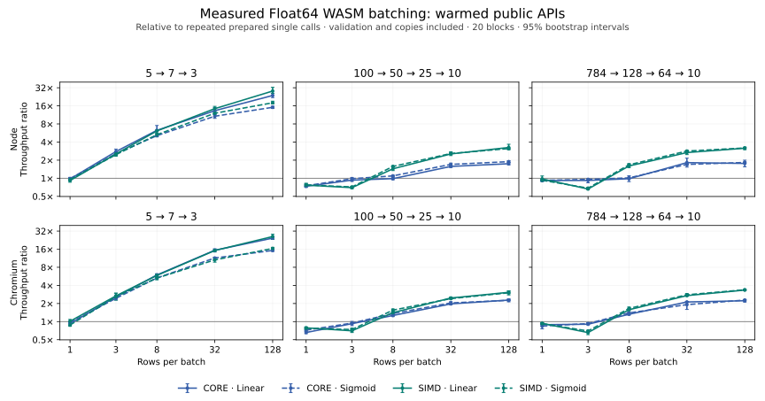

# Batched inference and calibration performance

Measured on **2026-11-08 UTC**, against repository baseline
`a3675099181c89c045b3638a61dc52b678f1756c`. The changes add reusable native and
WASM batches, accelerate the existing interval algorithm, and select a measured
release profile. The final rebuilt WASM bytes match the benchmarked bytes.



## What changed

`PreparedNetwork<f32/f64>` now accepts a fixed-capacity `BatchWorkspace`.
Public input/output arrays remain row-major; internal scratch places independent
samples next to one another. The WASM SIMD build uses f32x4/f64x2 multiply and
add instructions across samples. Each sample retains connection order, sparse
indices and duplicate connections. There is no reassociation, FMA, quantization,
new unsafe code, or new runtime dependency. Small batches use local scalar
accumulators where appropriate.

JavaScript creates a batch with `prepared.create_batch(capacity)` and calls
`batch.run_into(inputs, outputs, rows)`. It shares immutable model weights,
preallocates numeric scratch/staging, and survives freeing the parent prepared
handle. Validation and copying remain part of each measured call. Shape,
primitive-number, finite-value, array-buffer, memory and work checks preserve
caller output on failure. The [npm guide](../ruv-swarm/npm/README.md#reuse-prepared-inference)
explains capacity, empty batches, ownership and limits.

Calibration now sorts borrowed record references into contiguous windows,
looks up owned groups using borrowed names, and emits canonical interval order
directly. Quantiles use exact partial selection only for groups with at least
1,024 scores; smaller groups keep full sorting. Borrowed JSON serialization
removes temporary per-row maps and string clones while retaining wire bytes.
The statistical algorithm, timestamps, limits and forecasting assumptions in
the [research review](research-sota-2026-11-08.md) are unchanged.

## Actual WASM performance

These **128-row Linear Float64 SIMD** results compare a whole batch with
repeated prepared single calls **in the same final binary**. A ratio above one
means greater throughput. Latencies are means per row, derived from timed
blocks; they do not imply a nanosecond-resolution clock.

| Network | Node 24.22.1 latency | Node speed ratio [95% interval] | Chromium 156 latency | Chromium speed ratio [95% interval] |
| --- | ---: | ---: | ---: | ---: |
| 5 → 7 → 3 | 83.31 ns | 28.20× [25.60, 32.50] | 87.63 ns | 25.96× [23.31, 28.36] |
| 100 → 50 → 25 → 10 | 2.112 µs | 3.25× [2.99, 3.68] | 2.215 µs | 3.07× [2.91, 3.23] |
| 784 → 128 → 64 → 10 | 29.375 µs | 3.16× [2.99, 3.29] | 29.021 µs | 3.35× [3.26, 3.44] |

For the largest row above, comparison with the **previous release's allocating
legacy API** instead gives 5.62× in Node [4.81, 7.01] and 4.78× in Chromium
[4.66, 4.90]. This separate comparison combines batching, compilation and API
changes; it does not isolate SIMD. All three comparisons, ordinary/SIMD variants,
Linear/Sigmoid activations and batch sizes 1/3/8/32/128 are in the raw records.

One-row batches usually lose to prepared single inference: same-binary ratios
span 0.74–0.99× in Node and 0.66–1.01× in Chromium. SIMD batch size three also
loses on some larger networks. The chart includes these regressions. Choose
single inference when it fits the workload; a SIMD feature flag alone does not
establish a speedup.

The interval API also improves against the saved previous binaries. Across all
12 JSON workloads and both variants, fit-and-free ratios span 1.98–3.32× in Node
and 2.23–3.12× in Chromium; apply-and-serialize spans 2.28–5.32× and 2.43–4.12×.
These include JSON parsing/emission and returned-string allocation.

| SIMD workload / operation | Node before → after | Chromium before → after |
| --- | ---: | ---: |
| 10,000 records, one group, one coverage: fit/free | 23.153 → 7.671 ms | 23.689 → 8.399 ms |
| 9,600 records, 480 groups, 16 coverages: fit/free | 23.394 → 8.939 ms | 22.419 → 7.730 ms |
| Same fitted case, 7,680 output rows: apply JSON | 32.895 → 10.501 ms | 25.945 → 10.064 ms |

The two runtimes each compared **24 old/new calibration results byte for byte**,
including shuffled inputs. Every measured inference output has maximum absolute
error zero against the corresponding legacy results.

## Choosing the release profile

The initial SIMD build performed vector arithmetic but lost to ordinary batching
in several medium/large cases. Disassembly showed scalar lane packing and
extraction despite inlining. We preserved that build, changed only Rust's
release optimization level from `z` to `3`, and repeated the full shared suites.

| Runtime / variant | Median O3 / size-profile throughput across 30 batch cases | Min–max |
| --- | ---: | ---: |
| Node / ordinary | 1.54× | 1.15–3.58× |
| Node / SIMD | 3.07× | 1.24–7.62× |
| Chromium / ordinary | 1.62× | 0.97–3.04× |
| Chromium / SIMD | 2.57× | 1.04–5.84× |

These are medians of per-case mean-throughput ratios from separate runs, not
paired cross-profile experiments or a universal gain. A small Chromium ordinary
case regressed 2.8% in the point estimate. The profile is explicit in
[Cargo.toml](../ruv-swarm/Cargo.toml); fat LTO, one codegen unit, overflow checks
and panic behavior remain intact.

| Binary | Current size profile | Final speed profile | Increase |
| --- | ---: | ---: | ---: |
| Ordinary | 403,100 bytes | 467,876 bytes | 64,776 bytes (16.1%) |
| SIMD | 400,865 bytes | 466,518 bytes | 65,653 bytes (16.4%) |

## Native results

The native comparison uses Rust release builds and both f32/f64 on three dense
Linear/Sigmoid shapes. Across 48 cases, output error is zero. At 32 rows,
batch throughput is 1.37–5.40× repeated prepared single inference. At one row it
is 0.60–0.97×; at three rows 0.74–1.01×; at eight rows 0.91–1.86×. Native models
include bias connections and have their own fixtures; their numbers do not
predict the JavaScript path.

Across 12 native calibration configurations with 1/4/16 coverages, fit medians
improve 2.61–9.28× and apply medians 1.14–5.27×. The 100,000-record,
10,000-group, 16-coverage case changes fit from 63.109 to 20.705 ms and apply
from 54.617 to 10.358 ms. All 24 old/new fit/apply fingerprints match, with
independent full-sort and interval-field checks outside timings.

Native CSVs retain medians of nine samples; calibration also retains p10/p90.
Individual native timing samples were not retained, so no native confidence
interval is inferred from those summaries. The complete WASM sample arrays are
retained separately.

## Measurement and correctness

The host is an AMD EPYC 9V74 Linux container with a four-core CPU quota.
Toolchains: Rust 1.99.1, wasm-pack 0.15.1, Node 24.22.1 and Chromium
156.0.8078.79. Benchmarks ran without builds, installs or Ruflo daemons.
Each exact API is warmed, bounded iterations target about 3 ms per block, and
call order rotates across 20 inference blocks or 12 calibration blocks.
Compilation, fixture generation and output verification are outside timings;
public API guards, numeric transposition/copies and allocating baselines remain
inside. Batch construction is one separately reported observation, not a
cold-start distribution or memory-use measurement.

The report computes 95% percentile bootstrap intervals using 5,000 resamples and
seed 20261108. Same-binary API ratios resample paired timing-block indices.
Previous/current artifacts ran sequentially and use independent resampling.
Intervals describe sampled timing variability; host drift, other machines,
additional networks, sparse throughput and production concurrency are outside
that uncertainty estimate. Absolute performance is not independently replicated
on another host. No forecasting-accuracy or external leaderboard claim follows.

Validation includes zero-allocation native steady-state checks; all 21
activations on dense/sparse networks; f32/f64 SIMD execution in actual Chromium;
odd tails, zero/varying rows and late-error atomicity; parent lifetime/mutation;
typed-array spoofing, aliases, detached/shared/module-memory buffers; and
resource-limit recovery. The f32/f64 probe checks 2,310 rows per precision,
bit for bit. WABT 1.0.42 traces direct callees from the actual exported batch
entry points and confirms f64x2/f32x4 multiply/add instructions. Bytecode
inspection and browser execution are separate checks.

Independent security review found and fixed an underestimated single-wrapper
storage count and a work-budget bypass for many disconnected activated neurons.
The latter has a 30,000-layer, zero-edge regression fixture. All nine existing
dependency lockfiles remain unchanged. The machine-readable
[validation receipt](ultra-validation-2026-11-08.json) records tests and hashes.

## Reproduce and inspect

The [Node records](benchmarks/node-2026-11-08.json) and
[Chromium records](benchmarks/browser-2026-11-08.json) retain every raw block,
iteration count, checksum, binary hash and derived interval. Native CSVs:
[batches](benchmarks/native-batch-2026-11-08.csv),
[calibration before](benchmarks/native-calibration-before-2026-11-08.csv),
[calibration after](benchmarks/native-calibration-after-2026-11-08.csv).
The [profile summary](benchmarks/summary-2026-11-08.json) records the experiment.

```bash
# Extract the actual previous committed binaries, without rebuilding them.
mkdir -p /tmp/ruv-fann-before
git archive a367509 ruv-swarm/npm/wasm | tar -x -C /tmp/ruv-fann-before
npm --prefix ruv-swarm/npm run build
node ruv-swarm/npm/examples/benchmark-throughput.mjs --baseline /tmp/ruv-fann-before/ruv-swarm/npm/wasm
CHROMIUM_BIN=/path/to/chromium node scripts/benchmark-throughput-browser.cjs --baseline /tmp/ruv-fann-before/ruv-swarm/npm/wasm

cargo build --release --locked --no-default-features --example prepared_batch_benchmark
target/release/examples/prepared_batch_benchmark
cargo build --release --locked --no-default-features --example calibration_benchmark
target/release/examples/calibration_benchmark
```

Use the same compiler and host for both revisions. The drivers also accept
`--wasm-dir` to compare isolated candidate builds. Capture stdout as JSON and
keep progress on stderr. `scripts/report-throughput.py EVIDENCE_DIR` regenerates
the committed compact data, plots and bootstrap intervals from the saved Node,
Chromium and native files; it uses offline NumPy/Matplotlib, not runtime packages.
Published raw evidence and candidate archives remain immutable.
