# RuFANN on the ESP32 C5

Run a small evidence scorer directly on the ESP32 C5. Give it two numbers, one for evidence in the target room and one for evidence in an adjacent room. The scorer returns how much the local evidence exceeds the adjacent evidence after subtracting a margin. A cap limits the largest score.



The [build script](build.rs) reads the [RuFANN JSON checkpoint](model.json) and turns its two hidden biases into integer constants. The [scorer](src/lib.rs) uses those constants with integer arithmetic and requires no heap allocation. A caller supplies the two evidence values. For a RuView installation, a WiFi sensing worker could calculate them from two room windows before calling `score`.

## Work through a score

The input scale is called **Q10**. Here, `0` means zero evidence, `512` means half, and `1024` means one. The supplied model uses a margin of `128` (`0.125`) and caps the score at `768` (`0.75`).

```text
score = clamp(local − adjacent − 128, 0, 768)
```



| Situation | Local | Adjacent | Result |
| --- | ---: | ---: | --- |
| Local evidence clearly leads | 896 | 256 | `512` or `0.50` |
| Local lead just meets the margin | 640 | 512 | `0` |
| Evidence next door is stronger | 256 | 768 | `0` |
| Large local lead | 1024 | 0 | `768` or `0.75` |
| An input exceeds the valid range | 1025 | 0 | `None` |

For the first row, `896 − 256 = 640`. Subtract the margin of `128` and the result is `512`, or `0.50` on the normalized scale. Interpret zero as insufficient local lead. Your application decides when to act on a positive score.

```rust
use ruv_fann_esp32_c5::score;

assert_eq!(score(896, 256), Some(512));
assert_eq!(score(256, 768), Some(0));
assert_eq!(score(1025, 0), None);
```

## Change the margin

The example accepts the two ReLU units and linear output shown in `model.json`. Keep the weights and layer layout in that checkpoint. To try a stricter margin of `0.25` with the same cap of `0.75`, set the first layer’s `bias` to `[-0.25, -1.0]` and rebuild. The first bias is the negative margin. The second is the negative sum of the margin and cap. Both hinge values must fit the Q10 grid exactly and lie within `0` to `1` before negation.

With the stricter model, the same `896` and `256` inputs produce `384` (`0.375`). Run `cargo test --locked` after each edit to check the scorer against RuFANN.

## Build and check it

Use Rust 1.90 or newer and run these commands from the repository root.

```sh
cd examples/esp32-c5
cargo test --locked
rustup target add riscv32imac-unknown-none-elf
cargo build --locked --release --features firmware --target riscv32imac-unknown-none-elf
```

The host tests compare all 1,089 grid scores with the RuFANN core and check the input range. For an emulator run, use [espflash](https://docs.espressif.com/projects/rust/book/getting-started/tooling/espflash.html) and [Espressif’s emulator](https://github.com/espressif/esp-emulator) from the same directory.

```sh
image=target/riscv32imac-unknown-none-elf/release/ruvfann-c5
espflash save-image --chip esp32c5 --merge --skip-padding "$image" /tmp/ruvfann-c5-flash.bin
esp-emu --chip esp32c5 --firmware /tmp/ruvfann-c5-flash.bin --console usb-jtag --timeout 10s --exit-on 'ruvfann-c5 PASS'
```

To run the firmware on an ESP32 C5 development board, connect it over USB and use `espflash`.

```sh
espflash flash --monitor --chip esp32c5 target/riscv32imac-unknown-none-elf/release/ruvfann-c5
```

The boot self test reports `ruvfann-c5 PASS cases=1089`. With the supplied checkpoint it reports `margin_q10=128` and `cap_q10=768`. The elapsed time covers the whole self test, including its reference calculation.

For a room sensing pilot, replay labeled windows from the target room and adjacent room. Compare decisions with the current detector on the same windows. Then measure scoring latency and CSI packet drops on a physical C5 while WiFi capture is active.
