# neuro-divergent-data

Prepare and validate time series without pulling in Polars or the neural network engine. This crate provides array-backed series, scalers, missing-value strategies, lag and rolling features, calendar features, and validation helpers.



## Standardize a series

```rust
use neuro_divergent_data::preprocessing::{Scaler, StandardScaler};

fn main() -> Result<(), Box<dyn std::error::Error>> {
    let training = [10.0_f64, 12.0, 14.0];
    let mut scaler = StandardScaler::new();
    let scaled = scaler.fit_transform(&training)?;
    assert!(scaled[1].abs() < 1e-12);
    let future = scaler.transform(&[16.0])?;
    assert!(future[0] > 0.0);
    Ok(())
}
```

Fit the scaler only on the training period. The standard scaler computes population variance using a stable single pass; scale-only mode divides by standard deviation without subtracting the mean. Constant series use a scale of one. Invalid fitting input returns an error and retains the previously fitted statistics.

## Features and validation

The series builder sorts observations by timestamp. Lag and rolling features use past targets: a rolling window for time `t` ends before `t`. Feature blocks with different warmup lengths are aligned to their common final timestamps. Zero-sized rolling windows return an error. Caller-supplied exogenous data must still be checked against the forecast cutoff.

Validation can check missing values, temporal order, outliers, and configured value ranges. A range supplied with `with_value_range` enables that check. Validation policies and transformations are explicit; there is no automatic training or cross-validation engine in this crate.

## Validate

From the repository root:

```sh
cargo test --manifest-path neuro-divergent/Cargo.toml -p neuro-divergent-data --lib --locked
```

Tests cover scaler round trips and invalid refits, large offsets, feature alignment, past-only rolling windows, zero windows, and validation rules. `serde_support` enables serializable arrays and series; `parallel` enables Rayon support. `simd` is a marker rather than a separate vectorized implementation. This crate still requires the standard library. The former missing `loaders`, `crossval`, `transforms`, and `augmentation` modules are not exported.

See the [family review](https://github.com/ruvnet/ruv-FANN/blob/main/docs/review-forecasting.md) for exact results and the 0.2.0 candidate changes.
