# ruv-fann — neural networks, WebAssembly and weight-space programming

Build small neural networks you can **run, train, inspect and change locally**. `ruv-fann` combines Rust-backed WebAssembly inference and SGD/AdamW training with explicit tools for weight-space programming: trace activations, search bounded edits, test independent holdouts and promote a model revision by choice.

<p align="center">
  <a href="https://ruvnet.github.io/ruv-FANN/">
    
  </a>
</p>

[Explore the interactive field guide and live WASM demo](https://ruvnet.github.io/ruv-FANN/) · [View the illustrated workflow](https://raw.githubusercontent.com/ruvnet/ruv-FANN/main/packages/core/assets/weight-toolkit.svg)

[](https://www.npmjs.com/package/ruv-fann)
[](https://github.com/ruvnet/ruv-FANN/blob/main/packages/core/LICENSE)
[](https://nodejs.org/)

[Quick start](#quick-start) · [Weight editing](#edit-weights-test-holdouts-and-promote-explicitly) · [Capabilities](#capability-entrypoints) · [Training](#train-a-neural-network) · [Browser setup](#browser-setup) · [AgentDB](#persist-models-with-agentdb)

## What can you build?

- **Local scoring and agent components:** reusable batch inference for small dense models, reranking features and application-specific numeric decisions.
- **Inspectable neural experiments:** real WASM activation traces, hidden-neuron ablation and numerical sensitivity to selected weights.
- **Controlled model improvement:** bounded coordinate search, regression suites, finite-domain invariants, explicit promotion and rollback.
- **AgentDB workflows:** persisted weight programs behind a caller-owned authority, with serialized revisions and explicit durability acknowledgement.
- **Deployment tools:** public Hugging Face dense JSON checkpoint loading, Cloudflare Worker handlers and bounded Node.js proposal workers.

These tools operate on the versioned dense-layer model format. They do not turn this package into an LLM, general transformer loader, distributed training system or automatic production optimizer. Finite-domain tests give evidence for the inputs you tested; numerical sensitivity is a finite-difference estimate, not autograd.

## Choose your package

| Package | Choose it when | Installed dependencies |
| --- | --- | --- |
| **[ruv-fann](https://www.npmjs.com/package/ruv-fann) 0.2.0** | You want inference/training plus the toolkit available through explicit `ruv-fann/*` imports | WASM, WSP and twelve toolkit packages, at exact versions |
| [ruv-fann-wsp](https://www.npmjs.com/package/ruv-fann-wsp) 0.2.0 | You need only weight inspection, edits, evaluation and local revision workspaces | Published core 0.1.2 → WASM 0.1.2 |
| [ruv-fann-wasm](https://www.npmjs.com/package/ruv-fann-wasm) 0.1.2 | You want direct wasm-bindgen objects and manual memory ownership | No runtime dependencies |
| [Individual toolkit packages](https://github.com/ruvnet/ruv-FANN/tree/main/packages/wsp-toolkit#readme) | You want a particular integration with a smaller installation | Only that package's declared dependencies |

The root import remains small and loads only the numerical runtime. Installing core 0.2.0 installs the complete toolkit; choosing a subpath controls what your application imports, not what npm downloads. The Cloudflare build integration brings `esbuild` and its platform-specific optional executable. The neural runtime itself requires no native addon build or Rust toolchain. AgentDB is an optional integration and is not installed automatically.

ESM only; Node.js 20.9+ or a browser with WebAssembly support. Model inference and training run locally. Node reads bundled WASM from disk without a runtime download; fetching a Hub model or public package metrics happens only when you explicitly invoke those integrations.

## Install

```sh
npm install ruv-fann@0.2.0
```

TypeScript declarations, the WASM runtime and toolkit dependencies are included. Start with `import { loadRuntime } from 'ruv-fann'`; import other capabilities only where needed.

## Quick start

Save this as `predict.mjs`, then run `node predict.mjs`. This one-layer model computes `y = 2x + 1` for three inputs in one batch.

```js
import { loadRuntime } from 'ruv-fann';

const runtime = await loadRuntime({ simd: 'auto' });
const model = {
  schema: 'ruv-fann.dense-layers/1',
  layers: [{
    inputs: 1, outputs: 1,
    weights: [2], bias: [1],
    activation: 'Linear', steepness: 1
  }]
};

const prepared = runtime.prepare(model, { maxRows: 128 });
try {
  const predictions = prepared.predict(Float64Array.of(1, 2, 3));
  console.log([...predictions]); // [3, 5, 7]
  console.log(runtime.backend);  // 'wasm' or 'wasm-simd'
} finally {
  prepared.dispose();
}
```

Prepare once and reuse the model across batches. To reuse your own output array, call `prepared.predictInto(inputs, outputs)` before disposing the model. Inputs are row-major `Float64Array`s; the output length is `rows * outputSize`.

## Train a neural network

This complete example learns `y = 2x` with full-batch gradient descent. Switch `optimizer` to `'adamw'` to use AdamW.

```js
import { loadRuntime } from 'ruv-fann';

const runtime = await loadRuntime();
const initialModel = {
  schema: 'ruv-fann.dense-layers/1',
  layers: [{
    inputs: 1, outputs: 1,
    weights: [0], bias: [0],
    activation: 'Linear', steepness: 1
  }]
};
const result = runtime.train(initialModel, {
  inputs: Float64Array.of(0, 1, 2, 3),
  targets: Float64Array.of(0, 2, 4, 6),
  rows: 4, epochs: 200, learningRate: 0.05,
  optimizer: 'sgd'
});
console.log({ initialLoss: result.initialLoss, finalLoss: result.finalLoss });

const trained = runtime.prepare(result.model);
try {
  console.log([...trained.predict(Float64Array.of(4))]); // approximately [8]
} finally {
  trained.dispose();
}
// Serialize the trained weights for later use:
const checkpoint = JSON.stringify(result.model);
```

Training supports `Linear`, `Sigmoid`, `SigmoidSymmetric`, `Tanh` and `ReLU`. Calls are synchronous and bounded; use a Worker for longer browser tasks. Optimizer state starts fresh on each call and is not part of the JSON checkpoint.

## Edit weights, test holdouts and promote explicitly

Weight-space programming changes selected parameters directly instead of running an optimizer. A proposal stays separate from the active model until an explicit promotion succeeds. Save this complete example as `edit.mjs` and run `node edit.mjs`:

```js
import { createWeightWorkspace, fingerprintModel } from 'ruv-fann/wsp';
import { runRegressionGate } from 'ruv-fann/lifecycle';

const model = {
  schema: 'ruv-fann.dense-layers/1',
  layers: [{
    inputs: 1, outputs: 1, weights: [0], bias: [0],
    activation: 'Linear', steepness: 1
  }]
};
const development = { inputs: [0, 1, 2], targets: [1, 3, 5], rows: 3 };
// Separate inputs, never used to choose this proposed edit.
const holdout = { inputs: [0.5, 1.5], targets: [2, 4], rows: 2 };
const policy = { maxMSE: 0, maxRegressionMSE: 0, maxAbsoluteError: 0 };
const workspace = await createWeightWorkspace(model);
const baseline = workspace.snapshot();
const patch = {
  schema: 'ruv-fann.weight-patch/1',
  baseHash: await fingerprintModel(baseline.model),
  edits: [
    { layer: 0, parameter: 'weights', index: 0, value: 2 },
    { layer: 0, parameter: 'bias', index: 0, value: 1 }
  ]
};

const gate = await runRegressionGate({
  model: baseline.model, patch,
  suites: [
    { name: 'development', dataset: development, policy },
    { name: 'held-out-inputs', dataset: holdout, policy }
  ]
});
if (!gate.accepted) throw new Error('Independent regression gate rejected the edit');

const proposal = await workspace.propose(patch, development, policy);
if (!proposal.evaluation.accepted ||
    proposal.evaluation.baseHash !== gate.baseHash ||
    proposal.evaluation.candidateHash !== gate.candidateHash) {
  throw new Error('Proposal does not match the independently gated candidate');
}
// Expected revision rejects a stale update. No promotion occurs before this call.
const active = workspace.promote(proposal.id, baseline.revision);
console.log(active.revision, active.model.layers[0].weights); // 2 [2]
const restored = workspace.rollback(baseline.revision, active.revision);
console.log(restored.revision, restored.model.layers[0].weights); // 3 [0]
```

A hash binds model contents; it does not authenticate a caller. This local workspace is in memory. Your application must keep holdout data away from proposal selection, enforce its own access policy and choose when a passing gate authorizes promotion. Use the registry and loop entrypoints when you need explicit persistent authority and coordinated workers.

## Capability entrypoints

Core 0.2.0 provides fourteen explicit, typed subpaths. Each re-exports its corresponding package API; none is eagerly imported by `ruv-fann`.

| Import | Main capabilities | Environment |
| --- | --- | --- |
| `ruv-fann` | `loadRuntime`, reusable inference, SGD/AdamW training, `LIMITS` | Node.js and browsers |
| `ruv-fann/wsp` | `inspectWeightModel`, `traceWeightModel`, `analyzeWeightSensitivity`, patches, evaluation, workspaces | Node.js and secure-context browsers |
| `ruv-fann/search` | `searchWeightPatch`, experimental Boolean compilation and bounded Hebbian proposals | Node.js and secure-context browsers |
| `ruv-fann/lifecycle` | `runRegressionGate`, isolated `evaluatePatchBranches` | Node.js and secure-context browsers |
| `ruv-fann/invariants` | `checkModelInvariants`, finite Boolean-domain checks | Node.js and secure-context browsers |
| `ruv-fann/registry` | `createAgentDBRegistry`, serialized revisions and durability callbacks | Node.js; browser import with a supplied compatible authority |
| `ruv-fann/huggingface` | `loadHubModel`, `loadHubLinearHead`, integrity-pinned public dense JSON | Node.js; browsers subject to fetch/CORS policy |
| `ruv-fann/cloudflare` | `createWorkerHandler`, bounded stateless WSP requests | Cloudflare Workers; caller supplies authentication/runtime configuration |
| `ruv-fann/cloudflare/build` | `buildWorker`, bundled static WASM assets | Node.js build tooling |
| `ruv-fann/swarm` | `runProposalSwarm`, bounded fixed-operation worker proposals | Node.js worker threads |
| `ruv-fann/loop` | `runEvolutionLoop`, budgets, independent gates and authority-based promotion | Node.js worker threads |
| `ruv-fann/ruos` | `runWasmCanary`, validation commands and trusted host-result checks | Canary: Node.js/browsers; host commands: caller-controlled ruOS workflow |
| `ruv-fann/contracts` | Bounded constellation catalog and module validation | Node.js and browsers |
| `ruv-fann/constellation` | `readCatalog`, `planProfile`, explicit satellite scaffolding | Node.js filesystem tooling |
| `ruv-fann/telemetry` | Explicit public metric collection, analysis and HTML dashboard rendering | Node.js; browser imports, with fetch/CORS restrictions |

WSP imposes its own bounded edit, model, dataset and compute limits. Search, invariants, gates and loops add separate budgets; see each [toolkit package's API and limits](https://github.com/ruvnet/ruv-FANN/tree/main/packages/wsp-toolkit/packages). Experimental Boolean compilation is exact only on its complete binary input domain. Custom search objectives and registry callbacks are trusted application code, not a sandbox. The loop selects among fixed operations; it does not execute generated code or call an LLM provider.

### Dependency versions and compatibility

The new facade preserves already-published dependency contracts:

```text
ruv-fann@0.2.0
├─ ruv-fann-wasm@0.1.2
├─ ruv-fann-wsp@0.2.0 ─ ruv-fann@0.1.2 ─ ruv-fann-wasm@0.1.2
└─ twelve toolkit packages@0.1.0
   └─ WSP@0.2.0 and, where declared, core@0.1.2
```

This is a finite, versioned dependency graph: core 0.1.2 depends only on WASM, so it never imports core 0.2.0 or the facade. npm may install nested copies of core 0.1.2 to satisfy exact pins. Both generations share the dense-layer JSON format. The facade does not silently repoint old toolkit dependencies or promise a single JavaScript runtime cache across package generations. Keep their separate resolution when constructing a browser import map.

## Browser setup

The root inference/training API runs in browsers without loading Node-only capabilities. For a bundler-free deployment, copy the installed packages' `src` directories and the WASM package's `dist` directory into this layout:

```text
vendor/
  ruv-fann/src/
  ruv-fann-wasm/src/
  ruv-fann-wasm/dist/
```

```html
<script type="importmap">
{
  "imports": {
    "ruv-fann": "/vendor/ruv-fann/src/index.js",
    "ruv-fann-wasm": "/vendor/ruv-fann-wasm/src/index.js"
  }
}
</script>
<script type="module">
  import { loadRuntime } from 'ruv-fann';
  const runtime = await loadRuntime({ simd: 'auto' });
  console.log(runtime.backend);
</script>
```

Serve over HTTP(S), with `.wasm` files as `application/wasm`. Keep the WASM package's relative `src`/`dist` paths intact. Bundlers must preserve the dynamic binding imports and WASM asset URLs. Your Content Security Policy must allow WebAssembly compilation. The root-only map above needs no toolkit or legacy-core entries.

For browser WSP/search/gates, also copy the chosen packages and their transitive dependencies, map each `ruv-fann/*` wrapper and bare package name, and use import-map **scopes** so WSP/toolkit package URLs resolve their pinned `ruv-fann` to core 0.1.2. Do not globally replace that pin with core 0.2.0. A bundler can resolve these installed dependency versions for you, but still needs to preserve WASM assets. Use HTTPS or localhost for WebCrypto; do not import the Node-only worker, scaffold or build entrypoints into a browser bundle.

## API reference

| API | Result |
| --- | --- |
| `await loadRuntime({ simd: 'auto' })` | Cached runtime; automatically detects SIMD support |
| `runtime.prepare(model, { maxRows: 128 })` | Reusable, validated model snapshot |
| `prepared.predict(inputs, rows?)` | Caller-owned prediction array |
| `prepared.predictInto(inputs, outputs, rows?)` | Writes into an exact-length caller-owned array |
| `prepared.dispose()` | Releases the prepared model's native allocations |
| `runtime.train(model, options)` | New model, initial/final loss, epochs and parameter count |

### Runtime and backend selection

`loadRuntime({simd?: boolean | 'auto'})` initializes a cached `FannRuntime` with
`backend: 'wasm' | 'wasm-simd'`. Auto uses a real SIMD feature probe; explicit
SIMD rejects when unavailable. Node reads installed assets without network access.
For browser deployment, preserve the raw package's `src`/`dist` asset URLs and
see the `ruv-fann-wasm` README. No native addon or CommonJS entry is provided.

### Prepared models and batch inference

`runtime.prepare(modelOrJSON, {maxRows?: number})` owns an immutable packed
snapshot and one reusable batch. It exposes `inputSize`, `outputSize`, `maxRows`,
`estimatedBytes`, `predict(inputs, rows?)`, `predictInto(inputs, outputs, rows?)`,
and `dispose()`. Inputs are contiguous row-major `Float64Array`s. Omitted rows
are inferred from exact input length; explicit rows must match the whole input.
Outputs must have exactly `rows * outputSize` elements. Zero-row inference is
supported. Returned arrays are caller-owned copies; input/output aliasing is safe.
Changes to the source model do not change a prepared snapshot. Disposal is
idempotent, and subsequent predictions throw. Validation and numerical errors
preserve the whole supplied output buffer. A model does not expose raw WASM views.

### Model format

The versioned model uses flat `[outputs, inputs]` weights, optional per-output
`bias` (array or null), finite `steepness`, and case-sensitive native activation
names such as `Linear`, `Sigmoid`, `Tanh` and `ReLU` (see `DenseActivation` types
for all inference names). Adjacent layer dimensions must match. Unknown model
fields, shape errors, nonfinite values and unsupported schema versions reject.
Existing activation numerical conventions are preserved, including unscaled ReLU.

### Training behavior

`runtime.train(modelOrJSON, options)` performs synchronous full-batch MSE training
in WASM, returning `{model, initialLoss, finalLoss, epochs, parameterCount}`. Every
epoch performs exactly one fresh optimizer update; final loss is evaluated after
the last update. SGD is the default. AdamW uses beta1=0.9, beta2=0.999,
epsilon=1e-8, weightDecay=0; state is fresh per call and is not serialized.
Training supports Linear, Sigmoid, SigmoidSymmetric, Tanh and ReLU. Caller model,
inputs and targets are never changed. Training allocations are freed even when
an update fails. Large runs should be scheduled in a worker to keep the UI free.

### Resource limits

Bounds are exported as `LIMITS`: up to 4096 rows (prepared default 128), 64 layers,
65536 elements per dimension, 1 million parameters, 4 MiB UTF-8 model JSON,
64 MiB native storage per prepared batch/training object, and 1–1000 epochs.
A conservative JS preflight checks full layer widths, packed row descriptors,
inference workspace/staging, or training tape/adjoints/gradients and AdamW state
before entering either native constructor. It includes the temporary ordinary
prepared buffers alive during batch creation. The native layer independently
checks its exact storage budget.
Total synchronous training is also capped at 100 million conservative work units:
`(epochs + 1) * rows * (32 * parameters + 8 * (inputs + outputs) + 1)
+ epochs * 64 * parameters`. This uses the existing native training/update cost
policy across the whole call. Peak process memory also includes model conversion,
caller arrays, temporary JS copies, allocator slack and shared backend memory;
`estimatedBytes` is a conservative native object estimate, not process RSS.

### Input validation

Only finite primitive numbers and JS-owned, nonshared, nondetached Float64Arrays
are accepted at array boundaries. Exact lengths and row limits are enforced before
inference/training. WASM memory views, proxies and spoofed arrays reject.

## Persist models with AgentDB

[AgentDB 3.10.0](https://www.npmjs.com/package/agentdb/v/3.10.0) supports persisted neural checkpoints, revision-safe updates and weight-program workflows. Use the [neural model guide](https://github.com/ruvnet/agentdb/blob/main/docs/neural/ruv-fann.md) for controllers and MCP access policies.

`ruv-fann/registry` exposes `createAgentDBRegistry(programs, options)`. Supply your application's trusted `WeightPrograms` capability and explicit durability callbacks; the adapter serializes operations and reports persistence failures rather than treating an in-memory change as a durable acknowledgement. `ruv-fann/loop` consumes that authority through its registry interface. Neither importing core nor importing the registry opens a database, grants a model permission or installs AgentDB. Install/configure AgentDB separately if your application uses it, and close resources through their owning application.

## Validation and performance

Qualification uses fresh installed archives, real Node.js and Chromium WASM/SIMD inference and training, strict TypeScript for all fourteen capability subpaths, and independent numerical oracles for weight search, holdout gates, finite-domain checks, rejection and rollback. Browser import checks cover ten portable subpaths; Node-only integrations are tested in their own environments. A removed search wrapper must make installed-consumer qualification fail. Release publication separately requires the protected workflow and public archive byte verification; local source tests alone are not release evidence.

For a benchmark on your own machine, run `npm run benchmark` in `packages/core` of the [source repository](https://github.com/ruvnet/ruv-FANN). It compares batched calls with per-row calls and verifies matching outputs. Performance depends on model shape, batch size and hardware; SIMD availability alone does not guarantee a speedup.

## Source, support and license

- [Source code and TypeScript declarations](https://github.com/ruvnet/ruv-FANN/tree/main/packages/core)
- [Report an issue](https://github.com/ruvnet/ruv-FANN/issues)
- [Low-level WASM package](https://www.npmjs.com/package/ruv-fann-wasm)
- [MIT license](https://github.com/ruvnet/ruv-FANN/blob/main/packages/core/LICENSE)
