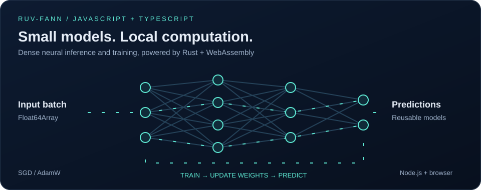

# ruv-fann — neural networks for JavaScript and TypeScript

Train and run dense neural networks in **Node.js and the browser** with a typed JavaScript API backed by **Rust and WebAssembly**. Use reusable batch inference, SGD or AdamW training, and automatic SIMD detection with one runtime dependency: `ruv-fann-wasm`.



[](https://www.npmjs.com/package/ruv-fann)
[](https://github.com/ruvnet/ruv-FANN/blob/main/packages/core/LICENSE)
[](https://nodejs.org/)

[Quick start](#quick-start) · [Training](#train-a-neural-network) · [API reference](#api-reference) · [Browser setup](#browser-setup) · [AgentDB](#persist-models-with-agentdb)

## Choose your package

| Package | Use it for | Runtime dependencies |
| --- | --- | --- |
| **[ruv-fann](https://www.npmjs.com/package/ruv-fann)** | Typed models, batch predictions, SGD/AdamW training, validation and managed allocations | `ruv-fann-wasm` (exact version) |
| [ruv-fann-wasm](https://www.npmjs.com/package/ruv-fann-wasm) | Direct wasm-bindgen access, backend memory and manual object ownership | None |

This SDK is useful for small dense models, local numeric scoring, learning experiments, and neural components in JavaScript agents. It runs model computation locally; Node loads the bundled WASM binaries from disk without a runtime download. ESM only; Node.js 20.9+ or a browser with WebAssembly support.

## Install

```sh
npm install ruv-fann
```

The WASM runtime is installed automatically. TypeScript declarations are included. No native addon build or Rust toolchain is needed to consume the npm package.

## Quick start

Save this as `predict.mjs`, then run `node predict.mjs`. This one-layer model computes `y = 2x + 1` for three inputs in one batch.

```js
import { loadRuntime } from 'ruv-fann';

const runtime = await loadRuntime({ simd: 'auto' });
const model = {
  schema: 'ruv-fann.dense-layers/1',
  layers: [{
    inputs: 1, outputs: 1,
    weights: [2], bias: [1],
    activation: 'Linear', steepness: 1
  }]
};

const prepared = runtime.prepare(model, { maxRows: 128 });
try {
  const predictions = prepared.predict(Float64Array.of(1, 2, 3));
  console.log([...predictions]); // [3, 5, 7]
  console.log(runtime.backend);  // 'wasm' or 'wasm-simd'
} finally {
  prepared.dispose();
}
```

Prepare once and reuse the model across batches. To reuse your own output array, call `prepared.predictInto(inputs, outputs)` before disposing the model. Inputs are row-major `Float64Array`s; the output length is `rows * outputSize`.

## Train a neural network

This complete example learns `y = 2x` with full-batch gradient descent. Switch `optimizer` to `'adamw'` to use AdamW.

```js
import { loadRuntime } from 'ruv-fann';

const runtime = await loadRuntime();
const initialModel = {
  schema: 'ruv-fann.dense-layers/1',
  layers: [{
    inputs: 1, outputs: 1,
    weights: [0], bias: [0],
    activation: 'Linear', steepness: 1
  }]
};
const result = runtime.train(initialModel, {
  inputs: Float64Array.of(0, 1, 2, 3),
  targets: Float64Array.of(0, 2, 4, 6),
  rows: 4, epochs: 200, learningRate: 0.05,
  optimizer: 'sgd'
});
console.log({ initialLoss: result.initialLoss, finalLoss: result.finalLoss });

const trained = runtime.prepare(result.model);
try {
  console.log([...trained.predict(Float64Array.of(4))]); // approximately [8]
} finally {
  trained.dispose();
}
// Serialize the trained weights for later use:
const checkpoint = JSON.stringify(result.model);
```

Training supports `Linear`, `Sigmoid`, `SigmoidSymmetric`, `Tanh` and `ReLU`. Calls are synchronous and bounded; use a Worker for longer browser tasks. Optimizer state starts fresh on each call and is not part of the JSON checkpoint.

## Browser setup

The same API runs in browsers. For a bundler-free deployment, copy the installed packages' `src` directories and the WASM package's `dist` directory into this layout:

```text
vendor/
  ruv-fann/src/
  ruv-fann-wasm/src/
  ruv-fann-wasm/dist/
```

```html
<script type="importmap">
{
  "imports": {
    "ruv-fann": "/vendor/ruv-fann/src/index.js",
    "ruv-fann-wasm": "/vendor/ruv-fann-wasm/src/index.js"
  }
}
</script>
<script type="module">
  import { loadRuntime } from 'ruv-fann';
  const runtime = await loadRuntime({ simd: 'auto' });
  console.log(runtime.backend);
</script>
```

Serve over HTTP(S), with `.wasm` files as `application/wasm`. Keep the WASM package's relative `src`/`dist` paths intact. Bundlers must preserve the dynamic binding imports and WASM asset URLs. Your Content Security Policy must allow WebAssembly compilation.

## API reference

| API | Result |
| --- | --- |
| `await loadRuntime({ simd: 'auto' })` | Cached runtime; automatically detects SIMD support |
| `runtime.prepare(model, { maxRows: 128 })` | Reusable, validated model snapshot |
| `prepared.predict(inputs, rows?)` | Caller-owned prediction array |
| `prepared.predictInto(inputs, outputs, rows?)` | Writes into an exact-length caller-owned array |
| `prepared.dispose()` | Releases the prepared model's native allocations |
| `runtime.train(model, options)` | New model, initial/final loss, epochs and parameter count |

### Runtime and backend selection

`loadRuntime({simd?: boolean | 'auto'})` initializes a cached `FannRuntime` with
`backend: 'wasm' | 'wasm-simd'`. Auto uses a real SIMD feature probe; explicit
SIMD rejects when unavailable. Node reads installed assets without network access.
For browser deployment, preserve the raw package's `src`/`dist` asset URLs and
see the `ruv-fann-wasm` README. No native addon or CommonJS entry is provided.

### Prepared models and batch inference

`runtime.prepare(modelOrJSON, {maxRows?: number})` owns an immutable packed
snapshot and one reusable batch. It exposes `inputSize`, `outputSize`, `maxRows`,
`estimatedBytes`, `predict(inputs, rows?)`, `predictInto(inputs, outputs, rows?)`,
and `dispose()`. Inputs are contiguous row-major `Float64Array`s. Omitted rows
are inferred from exact input length; explicit rows must match the whole input.
Outputs must have exactly `rows * outputSize` elements. Zero-row inference is
supported. Returned arrays are caller-owned copies; input/output aliasing is safe.
Changes to the source model do not change a prepared snapshot. Disposal is
idempotent, and subsequent predictions throw. Validation and numerical errors
preserve the whole supplied output buffer. A model does not expose raw WASM views.

### Model format

The versioned model uses flat `[outputs, inputs]` weights, optional per-output
`bias` (array or null), finite `steepness`, and case-sensitive native activation
names such as `Linear`, `Sigmoid`, `Tanh` and `ReLU` (see `DenseActivation` types
for all inference names). Adjacent layer dimensions must match. Unknown model
fields, shape errors, nonfinite values and unsupported schema versions reject.
Existing activation numerical conventions are preserved, including unscaled ReLU.

### Training behavior

`runtime.train(modelOrJSON, options)` performs synchronous full-batch MSE training
in WASM, returning `{model, initialLoss, finalLoss, epochs, parameterCount}`. Every
epoch performs exactly one fresh optimizer update; final loss is evaluated after
the last update. SGD is the default. AdamW uses beta1=0.9, beta2=0.999,
epsilon=1e-8, weightDecay=0; state is fresh per call and is not serialized.
Training supports Linear, Sigmoid, SigmoidSymmetric, Tanh and ReLU. Caller model,
inputs and targets are never changed. Training allocations are freed even when
an update fails. Large runs should be scheduled in a worker to keep the UI free.

### Resource limits

Bounds are exported as `LIMITS`: up to 4096 rows (prepared default 128), 64 layers,
65536 elements per dimension, 1 million parameters, 4 MiB UTF-8 model JSON,
64 MiB native storage per prepared batch/training object, and 1–1000 epochs.
A conservative JS preflight checks full layer widths, packed row descriptors,
inference workspace/staging, or training tape/adjoints/gradients and AdamW state
before entering either native constructor. It includes the temporary ordinary
prepared buffers alive during batch creation. The native layer independently
checks its exact storage budget.
Total synchronous training is also capped at 100 million conservative work units:
`(epochs + 1) * rows * (32 * parameters + 8 * (inputs + outputs) + 1)
+ epochs * 64 * parameters`. This uses the existing native training/update cost
policy across the whole call. Peak process memory also includes model conversion,
caller arrays, temporary JS copies, allocator slack and shared backend memory;
`estimatedBytes` is a conservative native object estimate, not process RSS.

### Input validation

Only finite primitive numbers and JS-owned, nonshared, nondetached Float64Arrays
are accepted at array boundaries. Exact lengths and row limits are enforced before
inference/training. WASM memory views, proxies and spoofed arrays reject.

## Persist models with AgentDB

[AgentDB 3.8.0](https://www.npmjs.com/package/agentdb/v/3.8.0) integrates the FANN SDK for persisted model checkpoints, revision-safe training updates and cached predictions. It provides six neural MCP tools: `agentdb_neural_create`, `agentdb_neural_get`, `agentdb_neural_list`, `agentdb_neural_predict`, `agentdb_neural_train` and `agentdb_neural_delete`.

See the [AgentDB neural model guide](https://github.com/ruvnet/agentdb/blob/main/docs/neural/ruv-fann.md) for controller usage and MCP access policies. AgentDB is an optional integration; it is not a dependency of this SDK.

## Validation and performance

The release workflow exercises real WASM inference and training on Node.js 22 and 24, Chromium, strict installed TypeScript declarations, mutation checks and fresh packed/public npm consumers. Both core and SIMD backends are exercised on capable hosts.

For a benchmark on your own machine, run `npm run benchmark` in `packages/core` of the [source repository](https://github.com/ruvnet/ruv-FANN). It compares batched calls with per-row calls and verifies matching outputs. Performance depends on model shape, batch size and hardware; SIMD availability alone does not guarantee a speedup.

## Source, support and license

- [Source code and TypeScript declarations](https://github.com/ruvnet/ruv-FANN/tree/main/packages/core)
- [Report an issue](https://github.com/ruvnet/ruv-FANN/issues)
- [Low-level WASM package](https://www.npmjs.com/package/ruv-fann-wasm)
- [MIT license](https://github.com/ruvnet/ruv-FANN/blob/main/packages/core/LICENSE)
