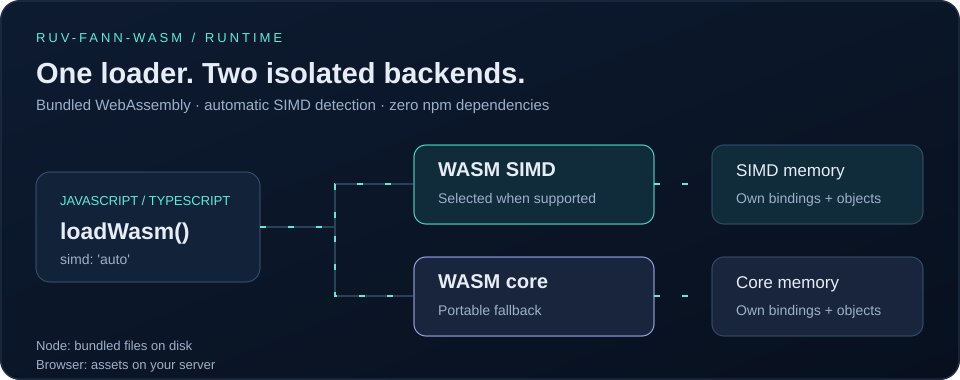

# ruv-fann-wasm — WebAssembly neural network runtime

Run **ruv-FANN neural networks in Node.js and browsers** with bundled Rust-compiled WebAssembly, generated wasm-bindgen bindings and automatic **SIMD** detection. This low-level ESM package has **zero npm runtime dependencies** and includes TypeScript declarations.

<p align="center">
  <a href="https://raw.githubusercontent.com/ruvnet/ruv-FANN/a482ab31934257e8b6b25c9b9bbaac9e341ae27c/packages/wasm/assets/wasm-runtime.svg">
    
  </a>
</p>

[View animated diagram](https://raw.githubusercontent.com/ruvnet/ruv-FANN/a482ab31934257e8b6b25c9b9bbaac9e341ae27c/packages/wasm/assets/wasm-runtime.svg)

[](https://www.npmjs.com/package/ruv-fann-wasm)
[](https://github.com/ruvnet/ruv-FANN/blob/main/packages/wasm/LICENSE)
[](https://nodejs.org/)

[Quick start](#quick-start) · [Backend selection](#backend-selection) · [Browser deployment](#browser-deployment) · [Package contents](#package-contents-and-scope)

## Choose your API

| Package | Best fit |
| --- | --- |
| [**ruv-fann**](https://www.npmjs.com/package/ruv-fann) | Start here for typed model objects, reusable batch inference, SGD/AdamW training and allocation management |
| **ruv-fann-wasm** | Use directly when you need raw wasm-bindgen classes, backend memory access or manual object ownership |

## Install

```sh
npm install ruv-fann-wasm
```

Requires Node.js 20.9+ or a browser with WebAssembly support. No native addon build or Rust toolchain is required to consume the package. Node loads the installed binaries from disk without a runtime download.

## Quick start

Save as `predict.mjs` and run `node predict.mjs`. The model computes `y = 2x + 1` for a single input.

```js
import { loadWasm } from 'ruv-fann-wasm';

const { bindings, backend } = await loadWasm({ simd: 'auto' });
const modelJSON = JSON.stringify({
  schema: 'ruv-fann.dense-layers/1',
  layers: [{
    inputs: 1, outputs: 1,
    weights: [2], bias: [1],
    activation: 'Linear', steepness: 1
  }]
});
const prepared = bindings.WasmPreparedNetwork.from_dense_layers_json(modelJSON);
try {
  console.log([...prepared.run(Float64Array.of(3))]); // [7]
  console.log(backend); // 'wasm' or 'wasm-simd'
} finally {
  prepared.free();
}
```

Raw native objects require explicit cleanup. Use `try/finally` and call `free()` exactly once when finished. For higher-level validation and idempotent disposal, use [ruv-fann](https://www.npmjs.com/package/ruv-fann).

## Backend selection

| Option | Behavior |
| --- | --- |
| `{ simd: 'auto' }` (default) | Probe WebAssembly SIMD support; select SIMD when available, otherwise core |
| `{ simd: false }` | Select the core WASM backend |
| `{ simd: true }` | Require SIMD; reject if unsupported |

`supportsSIMD()` is also exported for feature detection. SIMD selects a different compiled backend; measured speed depends on your workload and hardware.

`loadWasm({simd?: boolean | 'auto'})` returns `{bindings, backend, memory}`.
The default is `auto`, using a WebAssembly SIMD feature probe. `false` selects
`wasm`; `true` selects `wasm-simd` and rejects if unavailable. Core and SIMD use
separate generated module state, class constructors, memories and single-flight
initialization promises. Failed initialization can be retried. Raw objects belong
to their backend and must be freed by their owner. Do not pass raw objects between
backends, or use objects after `free()`.

## Browser deployment

Node reads installed binaries through `node:fs/promises`; it never downloads a
binary. Browser loaders fetch assets relative to the package. Serve `dist` beside
`src` (or configure your bundler to preserve their relative WASM URLs and dynamic
binding imports). Serve `.wasm` as `application/wasm`; CSP must permit WebAssembly.
No CommonJS entry point or native addon is provided.

## Package contents and scope

The binary contains existing compiled swarm/forecasting exports, but this package
loads no swarm runtime, SQLite or vector dependencies. For an ergonomic dense
inference/training API use `ruv-fann`.

## Reproducible assets

From the repository, `npm run build` verifies fixed SHA-256 hashes before copying
the previously built bindings and core/SIMD binaries from `ruv-swarm/npm/wasm`.
It does not compile Rust or replace unavailable operations. `dist/SHA256SUMS.json`
records the original source hashes; generated `core.js`/`simd.js` are byte-for-byte
binding copies. Build tools/tests are repository tooling and are excluded from the
published package.

## Browser example without a bundler

Copy the installed package's `src` and `dist` directories to `/vendor/ruv-fann-wasm/` on your server, preserving their relative locations:

```html
<script type="module">
  import { loadWasm } from '/vendor/ruv-fann-wasm/src/index.js';
  const { backend } = await loadWasm({ simd: 'auto' });
  console.log(backend);
</script>
```

The loader fetches its bindings and binaries from your deployment. It does not depend on a third-party CDN. For model training and batch predictions in the browser, see the [ruv-fann browser setup](https://github.com/ruvnet/ruv-FANN/tree/main/packages/core#browser-setup).

## Source, support and license

- [Loader source and TypeScript declarations](https://github.com/ruvnet/ruv-FANN/tree/main/packages/wasm)
- [Typed inference and training SDK](https://www.npmjs.com/package/ruv-fann)
- [Report an issue](https://github.com/ruvnet/ruv-FANN/issues)
- [MIT license](https://github.com/ruvnet/ruv-FANN/blob/main/packages/wasm/LICENSE)
