# ruv-fann toolkit — bounded weight search, model evaluation and adaptive revisions

Build a local improvement loop for small dense neural networks: propose a bounded weight edit, evaluate independent cases, check finite-domain output rules and explicitly activate a revision through your application's authority. Twelve ESM/TypeScript packages expose focused APIs for search, validation, worker coordination, checkpoint transport and package discovery.

[](https://ruvnet.github.io/ruv-FANN/)

**[Explore the illustrated field guide and real WASM demo →](https://ruvnet.github.io/ruv-FANN/)**

**Topics:** weight-space programming · neural network evaluation · bounded search · adaptive weight revisions · AgentDB persistence · Node.js worker threads · WebAssembly · Cloudflare Workers · integrity-pinned checkpoints.

## Install the complete facade or one capability

```sh
npm install ruv-fann@0.2.0
```

Core 0.2.0 keeps its root inference/training import and adds fourteen explicit subpaths, including `ruv-fann/wsp`, `ruv-fann/search`, `ruv-fann/invariants` and `ruv-fann/loop`. Installing the facade installs the complete toolkit, including the Cloudflare `esbuild` integration; importing the root does not eagerly load those capabilities. For a smaller installation, choose an individual package below. AgentDB is optional and supplied/configured by your application.

| Release component | Version | Role |
| --- | --- | --- |
| `ruv-fann` | **0.2.0** | Inference/training plus typed capability subpaths |
| Twelve toolkit packages below | **0.1.0** each | Independently installable capabilities |
| `ruv-fann-wsp` | **0.2.0**, existing public dependency | Weight patches, workspaces and diagnostics |
| `ruv-fann-wasm` | **0.1.2**, existing public dependency | Bundled scalar/SIMD numerical runtime |

The umbrella GitHub release is `ruv-fann-toolkit-v0.2.0`. The protected release lane qualifies thirteen new archives: core plus twelve toolkit packages. Public availability requires its publication and post-install receipts; a manifest version or catalog `published` declaration is not registry proof. WSP and satellites retain their exact published core 0.1.2 pins, producing a finite nested dependency graph; see [core compatibility and browser guidance](https://github.com/ruvnet/ruv-FANN/tree/main/packages/core#dependency-versions-and-compatibility).

## Capability map

| Individual package / core subpath | Use case | Public API |
| --- | --- | --- |
| [ruv-fann-wsp-lifecycle](packages/lifecycle/README.md)<br>`ruv-fann/lifecycle` | CI regression suites and isolated candidate snapshots | `runRegressionGate`, `evaluatePatchBranches`, `wsp-gate` CLI |
| [ruv-fann-wsp-search](packages/search/README.md)<br>`ruv-fann/search` | Bounded discrete optimization; experimental symbolic/plasticity proposals | `searchWeightPatch`, `compileBooleanTable`, `createHebbianPatch` |
| [ruv-fann-wsp-huggingface](packages/huggingface/README.md)<br>`ruv-fann/huggingface` | Commit-pinned, digest-verified public Hub JSON | `loadHubModel`, `loadHubLinearHead` |
| [ruv-fann-wsp-cloudflare](packages/cloudflare/README.md)<br>`ruv-fann/cloudflare` | Authenticated stateless HTTP operations and static WASM build | `createWorkerHandler`, `buildWorker` |
| [ruv-fann-wsp-ruos](packages/ruos/README.md)<br>`ruv-fann/ruos` | WASM lifecycle canary, shell plan, executor completion checks | `runWasmCanary`, `createValidationCommand`, `assertRuOSCompletion` |
| [ruv-fann-wsp-invariants](packages/invariants/README.md)<br>`ruv-fann/invariants` | Finite-domain output constraints and exhaustive Boolean checks | `checkModelInvariants`, `estimateInvariantWork`, `createBooleanInvariant` |
| [ruv-fann-wsp-swarm](packages/swarm/README.md)<br>`ruv-fann/swarm` | Real bounded proposal workers with separate WASM instances | `runProposalSwarm`, `estimateSwarmWork` |
| [ruv-fann-wsp-registry](packages/registry/README.md)<br>`ruv-fann/registry` | AgentDB revision authority with durable acknowledgements | `createAgentDBRegistry` |
| [ruv-fann-wsp-loop](packages/loop/README.md)<br>`ruv-fann/loop` | Autonomous local proposal/evaluation/promotion loop | `runEvolutionLoop` |
| [ruvnet-constellation-contracts](packages/contracts/README.md)<br>`ruv-fann/contracts` | Dependency-free catalog/module contracts and canonical IDs | `CONTRACTS`, `validateCatalog`, `validateModuleManifest` |
| [ruvnet-constellation](packages/constellation/README.md)<br>`ruv-fann/constellation` | Lightweight explicit discover/plan/scaffold onramp | `readCatalog`, `planProfile`, `scaffoldSatellite` |
| [ruvnet-constellation-telemetry](packages/telemetry/README.md)<br>`ruv-fann/telemetry` | Public cohort metrics, sampled project attach and standalone dashboard | `collectPublicMetrics`, `analyzeConstellation`, `renderConstellationDashboard` |

## Constellation onramp and dashboard

```sh
cd packages/wsp-toolkit
npm run constellation -- plan weights
npm run constellation -- plan local-loop
npm run constellation:report
```

The onramp plans explicit installs or source candidates and scaffolds reviewable local satellites. It installs no ML stack and collects no telemetry. The dashboard collects public metrics only when invoked; its HTML works offline. The release catalog declares 24 versioned packages, including the twelve toolkit packages. Catalog status guides planning; current registry observations and exact archive receipts establish actual availability. Measured project attach needs a separate consenting snapshot input; download correlations cannot establish it. See the [growth constellation guide](../../docs/constellation.md), [catalog](packages/constellation/catalog.json) and [protected release and optional OIDC setup](../../docs/constellation-release.md).

## Run

The qualification workspace needs Node 22.13+ (Miniflare requires Node 22). Published package candidates support Node 20.9+; the original five-package scenarios were also run on Node 20.20.2 through ruOS. The new loop uses Node worker threads; it does not run inside a browser or Cloudflare Worker.

```sh
cd packages/wsp-toolkit
npm ci --ignore-scripts --no-audit --no-fund
npm run setup:agentdb
npx playwright install --with-deps chromium
npm run validate
npm run demo:loop
```

Validation requires strict declarations, passing tests with zero skips/todos, matching packed-consumer behavior, a benchmark oracle and zero npm advisories across both installed locked dependency trees. The real AgentDB integration runtime is isolated under `tooling/agentdb`; setup omits its unrelated optional native/model packages and never downloads a model. `.artifacts/validation.json` records the test counts, benchmark, lockfile digest and source-file digests. `npm test`, `npm run test:unit`, `npm run test:e2e`, `npm run check:types`, `npm run benchmark`, `npm run audit` and `npm run test:loop` are also available separately.

The opt-in live Hub check uses a pinned public [source record](docs/huggingface-source.json):

```sh
npm run test:hub:live
# In managed Node 24 environments using an inherited HTTP proxy:
NODE_USE_ENV_PROXY=1 npm run test:hub:live
```

`ruv/ruview/presence-head.json` is an affine vector and bias. The explicit adapter maps these to a Linear layer and tests its arithmetic with synthetic inputs. This validates transport and declared affine semantics; it does not measure WiFi presence accuracy or reconstruct the source pipeline. No Hub token, upload or GPU job is needed.

## Run an autonomous loop

`npm run demo:loop` executes five proposal jobs with concurrency three against two small models. Search workers find shortcuts on development cases; the coordinator rejects three of them using held-out suites, validates the useful candidates against independent output constraints, then promotes two checkpoints through real AgentDB. The demo closes and reopens its SQLite file, verifies the exact revisions, rolls both models back, and reopens again to check persistence. It writes an inspectable report and database in a unique `.artifacts/evolution-*` directory.

```text
active AgentDB revision → fixed-operation proposal workers
                       → independent regression + invariant gates
                       → fresh AgentDB proposal → revision CAS promotion
                       → next bounded generation / restart / rollback
```

The loop has explicit round, proposal, work, worker, timeout and cancellation limits. Workers receive development cases only. Held-out data and acceptance rules remain with the coordinator. A worker result cannot authorize a commit. Active hashes are refreshed before declaring goals met, so another coordinator's rollback invalidates cached goal evidence. Tests exercise multiple generations, two concurrent loops, stale results, aborts and a real post-promotion disk-flush failure. See the [runnable scenario](test/evolution-scenario.mjs), [loop API](packages/loop/README.md), [delivery contract](docs/loop-design.md), and [loop validation](docs/loop-validation.md).

AgentDB 3.10.0/sql.js performs actual persistence in this implementation. The registry adapter accepts a caller-owned controller, serializes operations across awaits, and acknowledges writes only after its persistence callback succeeds. Failed persistence blocks further work until reopen. The fixture uses AgentDB's own WSP 0.1.0 controller dependency, while the coordinator independently checks candidates with WSP 0.2.0. The loop itself makes no provider calls, executes no generated code, publishes no package and performs no billing action. Package publication is a separate protected GitHub Actions operation, never an evolution-loop capability. RuVector/MetaHarness/Agentic Flow routing and universal verification remain extension points.

## Repair XOR, gate it independently and choose a revision

Save the complete example as `repair.mjs`, then run `node repair.mjs` after installing `ruv-fann@0.2.0`. The search receives one development row. Independent exhaustive cases determine whether its candidate is useful across the whole binary XOR domain.

```js
import { searchWeightPatch } from 'ruv-fann/search';
import { runRegressionGate } from 'ruv-fann/lifecycle';
import { createBooleanInvariant, checkModelInvariants } from 'ruv-fann/invariants';
import { createWeightWorkspace, applyWeightPatch } from 'ruv-fann/wsp';

const model = {schema: 'ruv-fann.dense-layers/1', layers: [
  {inputs: 2, outputs: 2, weights: [1,-1,-1,1], bias: [0,0], activation: 'ReLU', steepness: 1},
  {inputs: 2, outputs: 1, weights: [0,0], bias: [0], activation: 'Linear', steepness: 1}
]};
const development = {inputs: [0,1], targets: [1], rows: 1};
const holdout = {inputs: [0,0, 1,0, 1,1], targets: [0,1,0], rows: 3};
const policy = {maxMSE: 0, maxRegressionMSE: 0, maxAbsoluteError: 0};
const found = await searchWeightPatch(model, development, policy, {
  locations: [0,1].map(index => ({layer: 1, parameter: 'weights', index, values: [0,1]})),
  maxEvaluations: 8, maxPasses: 2
});
if (!found.patch) throw new Error('No improving candidate');
const gate = await runRegressionGate({model, patch: found.patch, suites: [
  {name: 'development', dataset: development, policy},
  {name: 'held-out-xor', dataset: holdout, policy}
]});
console.log('Independent holdout accepted:', gate.accepted); // false
// The development-only shortcut is rejected; active state stays unchanged.
const workspace = await createWeightWorkspace(model);
if (gate.accepted) throw new Error('Expected the one-row shortcut to fail the holdout');

// A separate explicitly authored candidate connects both useful hidden units.
const completePatch = {...found.patch, edits: [0,1].map(index =>
  ({layer: 1, parameter: 'weights', index, value: 1}))};
const checked = await runRegressionGate({model, patch: completePatch, suites: [
  {name: 'development', dataset: development, policy},
  {name: 'held-out-xor', dataset: holdout, policy}
]});
const candidate = await applyWeightPatch(model, completePatch);
const invariant = await checkModelInvariants(candidate,
  createBooleanInvariant({inputs: 2, outputs: 1, targets: [0,1,1,0]}));
if (!checked.accepted || !invariant.accepted || invariant.modelHash !== checked.candidateHash) {
  throw new Error('Independent gates rejected the complete candidate');
}
const baseline = workspace.snapshot();
const proposal = await workspace.propose(completePatch, development, policy);
if (!proposal.evaluation.accepted || proposal.evaluation.baseHash !== checked.baseHash ||
    proposal.evaluation.candidateHash !== checked.candidateHash) throw new Error('Gated candidate changed');
const active = workspace.promote(proposal.id, baseline.revision);
console.log('Promoted revision:', active.revision); // 2
console.log('Rollback revision:', workspace.rollback(baseline.revision, active.revision).revision); // 3
```

This deliberately small example illustrates a rejected shortcut, a passing finite-domain candidate and explicit activation. It is not evidence of generalization. Keep real application holdouts private from search, do not repeatedly tune against them, and give promotion authority only to trusted application code. The complete persistent multi-model demonstration is `npm run demo:loop` in the source workspace.

For a PR gate, write `{model,patch,suites:[{name,dataset,policy}]}` to JSON and run `wsp-gate file.json`: exit 0 accepts, 1 rejects, 2 reports invalid input/runtime failure. The [complete executable scenario](test/scenario.mjs) covers two-weight XOR repair, activation and derivative oracles, rejected ablation, branching, compiled Boolean logic, localized plasticity, a Hub transport fixture and rollback in Node and real Chromium.

## Platforms and boundaries

Cloudflare's builder statically imports both precompiled WASM modules. Its actual `workerd` tests verify scalar/SIMD evaluation, tracing, sensitivity, ablation and authentication. Default configuration denies operations without a bearer secret. The Worker has no persistence, promotion, outbound model fetch or code execution endpoint. See its package README for building and optional deployment; no live Worker was deployed by this task.

ruOS validation uses the observed Work Desktop executor, installs the same SHA-256-checked npm archives into a fresh temporary directory, builds the Worker, runs both packed WASM scenarios and repeats the live Hub check. The completion helper requires host-owned structured completion and never grants success from stdout text. It is a consistency check, not a cryptographic attestation or deployment permission.

The Boolean compiler covers complete truth tables of at most six binary inputs. Hebbian updates are bounded proposals requiring independent evaluation. Search allows trusted synchronous local objective callbacks, including discontinuous scores; its winner can still fail the authoritative regression policy. Callbacks are not sandboxes. Candidate branches share a runtime and are evaluated sequentially; they do not provide process isolation. No generalization, arbitrary safety-input repair, transformer editing, hidden behavioral keys or autonomous provider execution is claimed.

Performance qualification compares an identical 16-candidate one-coordinate sequence: cached baseline screening plus final authoritative validation uses 19 inference passes versus 32 for repeatedly evaluating both models. Timings are local observations. See the [original five-package validation](docs/validation.md), [current loop qualification](docs/loop-validation.md) and [delivery contract](docs/design.md).

## Release and source evidence

The [protected thirteen-package lane](https://github.com/ruvnet/ruv-FANN/blob/main/.github/workflows/protected-toolkit-release.yml) publishes only qualified exact archives from the reviewed main SHA, then verifies public bytes and fresh installed consumers. The existing WSP release publisher remains separate. New satellites bootstrap through the existing npm credential; the optional OIDC guard requires independently registered package-specific publishers before use. See [release setup](https://github.com/ruvnet/ruv-FANN/blob/main/docs/constellation-release.md) and [ADR-012](https://github.com/ruvnet/ruv-FANN/blob/main/docs/adr/ADR-012-weight-toolkit-release.md).

Historical `docs/evidence/*` files describe their recorded generations. They are retained unchanged and do not qualify a newer source commit. Current exact-source test counts, archive digests, publication receipts and installed-consumer results belong to the umbrella release artifacts.
