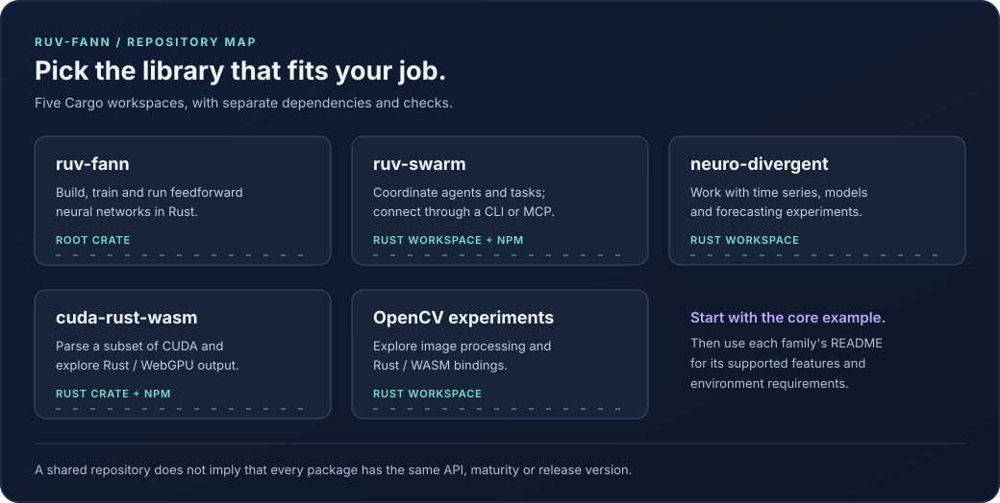

# swe-bench-adapter

Load local SWE-style instance JSON, generate prompts, parse execution output and evaluate an application-generated patch. The adapter is experimental and is not the official SWE-bench evaluation harness.

## Use real application output

`evaluate_instance_with_agent(instance_id, &mut agent)` requires an `Agent<Input = Task, Output = ExecutionResult>`. Implement that trait or use `ruv_swarm_agents::FunctionAgent` to connect your actual patch generator. The handler receives the generated task and returns its output, patch and exit code. Execution errors, nonzero exit codes and outputs over 16 MiB fail; execution duration is measured rather than supplied by a mock.

The old `evaluate_instance(instance_id, &agent)` and the legacy batch path return an error because a shared reference cannot invoke the mutable agent handler. They no longer fabricate a patch and report it as an agent result.

## Dataset handling

Place `{instance_id}.json` files in the configured instances directory. Missing instances return errors instead of creating mock data. IDs accept 1–200 ASCII letters, digits, underscores or hyphens. Symbolic links are rejected, each document is limited to 16 MiB, and its internal ID must match the requested ID. The cache accepts at most 1,000 documents and 64 MiB of source JSON.

The schema is this crate's `SWEBenchInstance` type; importing official datasets may require an explicit conversion. No dataset download or published solve-rate claim is included.

## Evaluation limits

The patch evaluator clones repositories and launches local processes. Its `sandbox_enabled` setting creates a temporary working directory; it does not provide container, kernel, network or credential isolation. Run untrusted code in an externally isolated environment. Pin repositories/revisions and use the official SWE-bench harness before reporting benchmark results.

The typed high-level path records one actual handler duration and does not attach simulated repeated timings, resource profiles or memory measurements. The older `BenchmarkRunner` remains a simulation helper and must not be treated as measured application performance. No accuracy or solve-rate figure is established by the unit tests.

## Check it

```sh
cargo test --locked -p swe-bench-adapter --lib
cargo test --locked -p swe-bench-adapter --test integration_test
```

Rust 1.88 all-target/all-feature coverage includes 18 library tests, six integration tests and 13 Criterion smoke cases. Tests invoke the actual typed handler and apply/check a patch in a local Git fixture, including preservation of an existing patch file. `PatchEvaluator::with_working_directory` supports an existing local checkout. Temporary patch files have unique names, and timed-out child processes are killed. These checks do not run the official benchmark or isolate untrusted code.

Published on [crates.io](https://crates.io/crates/swe-bench-adapter). Builds use rustls for TLS; no OpenSSL dependency. See the [workspace guide](https://github.com/ruvnet/ruv-FANN/tree/main/ruv-swarm) for all 14 packages and the [review record](https://github.com/ruvnet/ruv-FANN/blob/main/docs/review-rust-swarm.md) for checks, dependency findings and remaining limits.


